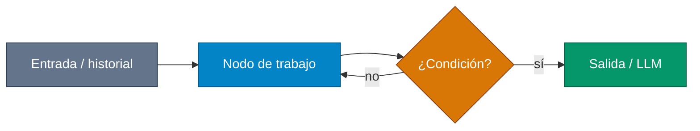

# Referencia — formatear-md-estudio

## Diagrama mínimo (copiar y adaptar)



Más clases según el tema:

```
classDef mem fill:#4F46E5,stroke:#312E81,color:#fff
classDef vec fill:#DB2777,stroke:#9D174D,color:#fff
```

Asignar **todos** los nodos. Varias IDs: `class A,B,C n`.

## Nota de estudio

```markdown
> **Para aclarar:** en LangGraph el checkpointer puede guardar todos los mensajes del hilo, pero el nodo del chatbot suele recortar la lista antes de `llm.invoke(...)`.
```

```markdown
> **Nota de implementación:** `should_summarize` encaja como routing (`"summarize"` vs `"continue"`) antes del nodo del LLM.
```

## Índice corto (artículos largos)

```markdown
### Índice de estudio

| # | Sección | Idea en una línea |
| --- | --- | --- |
| 1 | [Título](#ancla) | Resumen de una línea |

**Leyenda de colores:** índigo = estado / memoria · azul = procesamiento · verde = salida / LLM · naranja = decisión · gris = restricciones o entrada · rosa = vectorial.
```
