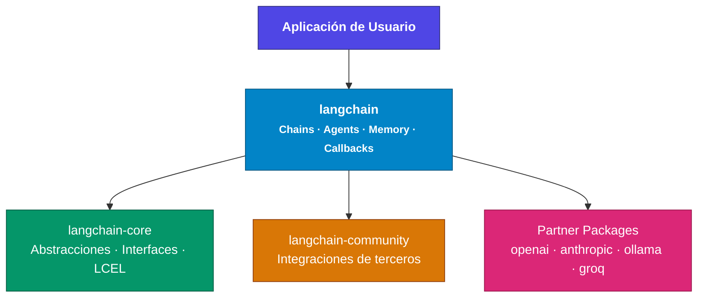

# Arquitectura de Paquetes en LangChain

En esta lección nos detendremos a comprender la arquitectura general de LangChain y su ecosistema al día de hoy.

Esto nos dará un **mapa mental** de cómo encajan las piezas: modelos, cadenas, agentes, memoria, herramientas, y también cómo **LangGraph** expande las capacidades de LangChain.

> Aunque no escribamos mucho código nuevo aquí, este conocimiento conceptual será muy útil cuando abordemos proyectos más complejos en secciones posteriores.

---

## Cómo se organiza el ecosistema

Antes de entrar en los componentes específicos, es importante entender cómo se organiza LangChain. El ecosistema se ha **modularizado** para mejorar la mantenibilidad, reducir dependencias y permitir instalaciones más ligeras.



---

## Los cuatro niveles principales

| Capa | Paquete | Rol |
| --- | --- | --- |
| Base | `langchain-core` | Abstracciones, interfaces y LCEL |
| Alto nivel | `langchain` | Chains, Agents, Memory, Callbacks |
| Comunidad | `langchain-community` | Integraciones de terceros |
| Oficiales | Partner packages | OpenAI, Anthropic, Ollama, Groq… |

### `langchain-core`

Contiene las **abstracciones fundamentales** e interfaces base. Aquí están clases como `BaseLanguageModel`, `BasePromptTemplate`, `Runnable`, y el corazón del **LCEL** (LangChain Expression Language).

Es la base sobre la que se construye todo lo demás.

### `langchain`

Capa de **alto nivel**: chains, agents, memory y callbacks. Es lo que suele usar la aplicación, apoyándose en el core y en los paquetes de integración.

### `langchain-community`

Integraciones con servicios y herramientas de terceros que **no** tienen soporte oficial optimizado.

Incluye conectores para bases de datos vectoriales de código abierto, loaders de documentos, herramientas diversas, etc.

### Partner packages

Paquetes separados, **mantenidos oficialmente**, para proveedores principales:

- `langchain-openai`
- `langchain-anthropic`
- `langchain-ollama`
- `langchain-groq`

Están **optimizados** y tienen mejor soporte que las integraciones genéricas de community.

---

## Ventajas de esta arquitectura

| Ventaja | Qué implica en la práctica |
| --- | --- |
| Instalaciones ligeras | Solo instalas lo que usas. Si trabajas con OpenAI: `langchain-core` + `langchain-openai`. |
| Mejor mantenimiento | Cada integración evoluciona por su cuenta. |
| Menos conflictos | Las dependencias de un proveedor no rompen el core. |
| Actualizaciones más rápidas | Un partner package puede salir sin esperar el release de `langchain`. |

---

## Implicaciones prácticas

Hoy, en el código, los imports suelen verse así:

```python
from langchain_core.prompts import ChatPromptTemplate
from langchain_openai import ChatOpenAI
from langchain_community.document_loaders import TextLoader
```

Cada pieza viene de **su propio paquete**, no de un único `langchain` monolítico.
