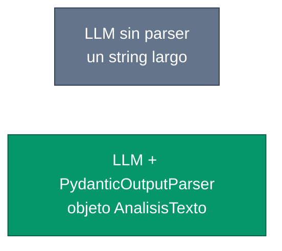
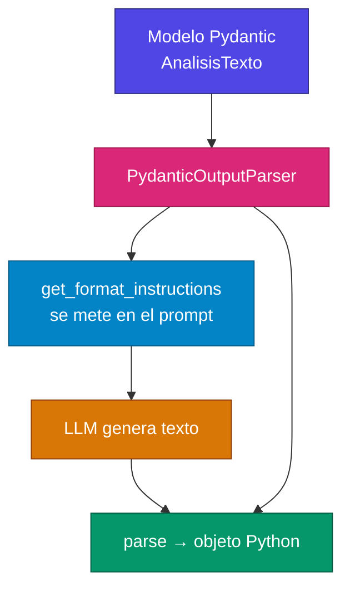
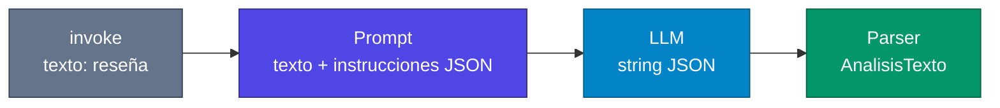

# Lectura: PydanticOutputParser: El Método Clásico para salidas estructuradas

Antes de que LangChain introdujera `with_structured_output()`, los desarrolladores usábamos `PydanticOutputParser` para obtener respuestas estructuradas de los modelos de lenguaje. Aunque es un método más verboso, sigue siendo ampliamente utilizado y te ayudará a entender los fundamentos del structured output.

> **Para aclarar:** un LLM, por defecto, devuelve **texto**. Si pides un resumen, un sentimiento y palabras clave, te llega un párrafo. El *structured output* obliga a que esa respuesta sea un objeto con campos fijos (`resultado.resumen`, `resultado.sentimiento`…), listo para usar en código.



---

## ¿Qué es PydanticOutputParser?

`PydanticOutputParser` es una clase que convierte las respuestas de texto libre de un LLM en objetos Python estructurados usando modelos de Pydantic. Funciona añadiendo instrucciones específicas al prompt y luego parseando la respuesta del modelo.

Eso son **dos momentos distintos**:

1. **Antes de llamar al modelo:** el parser escribe en el prompt *cómo* debe verse la respuesta (normalmente JSON con esos campos).
2. **Después de la respuesta:** el parser lee ese texto, lo valida con Pydantic y te entrega el objeto.



---

## Instalación de Dependencias

```bash
pip install langchain langchain-openai pydantic
```

---

## Ejemplo Completo Paso a Paso

### Paso 1: Definir el Modelo Pydantic

```python
from pydantic import BaseModel, Field

class AnalisisTexto(BaseModel):
    resumen: str = Field(description="Resumen breve del texto")
    sentimiento: str = Field(description="Sentimiento del texto (Positivo, neutro o negativo)")
    palabras_clave: list[str] = Field(description="Lista de palabras clave del texto")
```

**Explicación:**

- **BaseModel:** Clase base de Pydantic para crear modelos de datos
- **Field():** Permite añadir descripciones y validaciones
- Las descripciones son cruciales: el parser las usa para generar instrucciones

> **Para aclarar:** este `class` **no llama al modelo**. Solo declara el contrato: “el resultado tendrá estos tres campos, con estos tipos”. Si el LLM inventa un campo extra o deja `sentimiento` vacío, Pydantic puede rechazar la respuesta y saltará el `except`.

El objeto que quieres al final se parece a esto:

```python
AnalisisTexto(
    resumen="Película de ciencia ficción muy elogiada...",
    sentimiento="Positivo",
    palabras_clave=["ciencia ficción", "efectos visuales", "trama"]
)
```

### Paso 2: Crear el Parser

```python
from langchain.output_parsers import PydanticOutputParser

# Crear el parser con nuestro modelo
parser = PydanticOutputParser(pydantic_object=AnalisisTexto)

# Ver las instrucciones que genera automáticamente
print("Instrucciones generadas:")
print(parser.get_format_instructions())
```

> **Para aclarar:** `get_format_instructions()` no analiza texto. Genera un bloque de instrucciones (esquema JSON, nombres de campos, descripciones de los `Field`) para **pegárselo al LLM**. Por eso el modelo “sabe” que debe responder con `resumen`, `sentimiento` y `palabras_clave`.

### Paso 3: Crear el Prompt Template

```python
from langchain.prompts import PromptTemplate

prompt = PromptTemplate(
    template="""Eres un experto analista de texto. Analiza el siguiente texto con mucho cuidado y proporciona un análisis detallado.

{format_instructions}

Texto a analizar:
{texto}

Análisis:""",
    input_variables=["texto"],
    partial_variables={"format_instructions": parser.get_format_instructions()}
)
```

**Puntos importantes:**

- `{format_instructions}` se sustituye automáticamente con las instrucciones del parser
- `partial_variables` permite pre-llenar variables del template
- El prompt debe ser claro sobre qué esperas del modelo

> **Para aclarar la diferencia:**
>
> | Variable | Cuándo se rellena | Ejemplo |
> | --- | --- | --- |
> | `partial_variables` | Una vez, al crear el template | `format_instructions` (no cambia en cada análisis) |
> | `input_variables` | En cada `invoke` | `texto` (cambia con cada película, reseña, etc.) |
>
> Si `format_instructions` fuera `input_variable`, tendrías que pasarla a mano en **cada** `chain.invoke(...)`. Con `partial_variables` queda fijada.

### Paso 4: Configurar el LLM

```python
from langchain_openai import ChatOpenAI
import os

llm = ChatOpenAI(
    model="gpt-4o-mini",
    temperature=0.3,  # Baja temperatura para respuestas más consistentes
)
```

> **Para aclarar:** `temperature=0.3` reduce la creatividad. En structured output eso ayuda: el modelo se apega más al JSON y menos a prosa libre. `import os` aparece por si cargas la API key con `os.getenv`; `ChatOpenAI` también puede leer `OPENAI_API_KEY` del entorno solo.

### Paso 5: Crear la Cadena de Procesamiento

```python
# Crear la cadena: prompt → LLM → parser
chain = prompt | llm | parser
```


**¿Qué hace cada paso?**

- **Prompt:** Genera el mensaje completo con instrucciones
- **LLM:** Procesa el prompt y genera una respuesta
- **Parser:** Convierte la respuesta en un objeto Pydantic

El `|` es LCEL: la salida de un paso entra al siguiente.



Si pararas en `prompt | llm` (sin parser), `invoke` te devolvería un `AIMessage` con `.content` en texto. El parser es quien convierte ese texto en `AnalisisTexto`.

### Paso 6: Ejecutar el Análisis

```python
# Texto de ejemplo
texto_prueba = """
La nueva película de ciencia ficción 'Estrella Galáctica' es absolutamente
espectacular. Los efectos visuales son impresionantes y la trama mantiene
la tensión durante toda la película. Los actores principales entregan
actuaciones convincentes que realmente te hacen creer en este mundo futurista.
Sin duda una de las mejores películas del año.
"""

try:
    # Invocar la cadena
    resultado = chain.invoke({"texto": texto_prueba})

    # Acceder a los datos
    print("=== RESULTADO DEL ANÁLISIS ===")
    print(f"Resumen: {resultado.resumen}")
    print(f"Sentimiento: {resultado.sentimiento}")
    print(f"Palabras clave: {', '.join(resultado.palabras_clave)}")

    # Exportar como JSON
    print("\n=== JSON RESULTANTE ===")
    print(resultado.model_dump_json(indent=2))

    # Exportar como diccionario
    dict_resultado = resultado.model_dump()
    print(f"\nTipo de objeto: {type(resultado)}")
    print(f"Tipo de diccionario: {type(dict_resultado)}")

except Exception as e:
    print(f"❌ Error durante el procesamiento: {e}")
```

> **Para aclarar lo que sale de `invoke`:**
>
> | Expresión | Tipo | Uso |
> | --- | --- | --- |
> | `resultado` | `AnalisisTexto` | `resultado.resumen` |
> | `resultado.model_dump()` | `dict` | APIs, JSON genérico, pandas |
> | `resultado.model_dump_json()` | `str` | Guardar o imprimir JSON |
>
> El `try/except` cubre fallos típicos: el modelo no devolvió JSON válido, faltó un campo, o Pydantic no pudo validar.

---

## Código Completo Funcional

```python
from pydantic import BaseModel, Field
from langchain_openai import ChatOpenAI
from langchain.output_parsers import PydanticOutputParser
from langchain.prompts import PromptTemplate
import os

# 1. Modelo de datos
class AnalisisTexto(BaseModel):
    resumen: str = Field(description="Resumen breve del texto")
    sentimiento: str = Field(description="Sentimiento: Positivo, Neutro o Negativo")
    palabras_clave: list[str] = Field(description="3-5 palabras clave principales")

# 2. Parser
parser = PydanticOutputParser(pydantic_object=AnalisisTexto)

# 3. Prompt
prompt = PromptTemplate(
    template="""Analiza este texto cuidadosamente y proporciona un análisis estructurado:

{format_instructions}

TEXTO:
{texto}

ANÁLISIS:""",
    input_variables=["texto"],
    partial_variables={"format_instructions": parser.get_format_instructions()}
)

# 4. LLM
llm = ChatOpenAI(model="gpt-4o-mini", temperature=0.2)

# 5. Cadena
chain = prompt | llm | parser

# 6. Ejecución
if __name__ == "__main__":
    texto = "Me encantó la nueva película de acción, tiene efectos especiales increíbles."

    try:
        resultado = chain.invoke({"texto": texto})
        print("✅ Análisis exitoso:")
        print(resultado.model_dump_json(indent=2))
    except Exception as e:
        print(f"❌ Error: {e}")
```

Este script junta los seis pasos. El `if __name__ == "__main__"` hace que el análisis solo corra al ejecutar el archivo, no al importarlo.

---

## Conclusión

`PydanticOutputParser` sigue siendo una herramienta valiosa para obtener structured output en LangChain. Aunque requiere más código que los métodos modernos, te da control total sobre el proceso y funciona con cualquier modelo de lenguaje. Es especialmente útil cuando necesitas validaciones complejas o trabajas con modelos que no soportan function calling nativo.

> **Para ubicar el método clásico vs el moderno:**
>
> | | `PydanticOutputParser` (esta lección) | `with_structured_output()` |
> | --- | --- | --- |
> | Cómo obliga el formato | Instrucciones en el **prompt** + parseo después | Function calling / JSON nativo del proveedor |
> | Código | Más largo (modelo + parser + `{format_instructions}`) | Más corto |
> | Control | Ves instrucciones, texto crudo y validación | LangChain lo encapsula |
> | Cuándo usarlo | Modelos sin function calling, o validaciones muy explícitas | Modelos modernos (p. ej. GPT-4o) |
>
> Los dos pueden acabar en el mismo `BaseModel`. Cambia *cómo* se extrae, no el esquema Pydantic.
