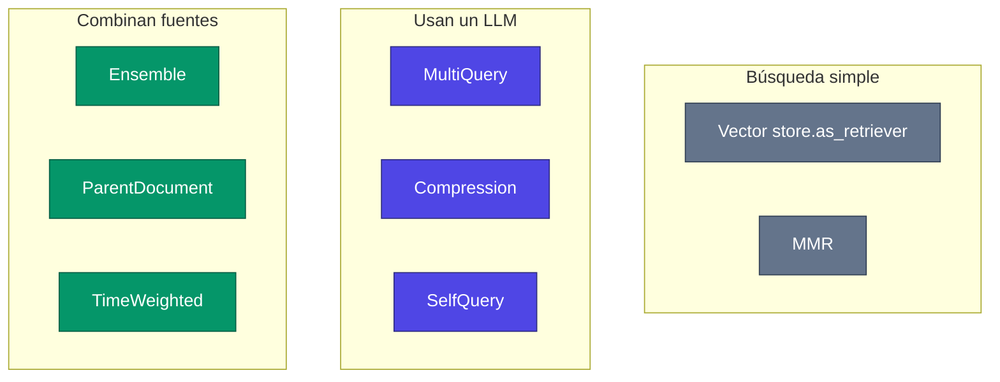
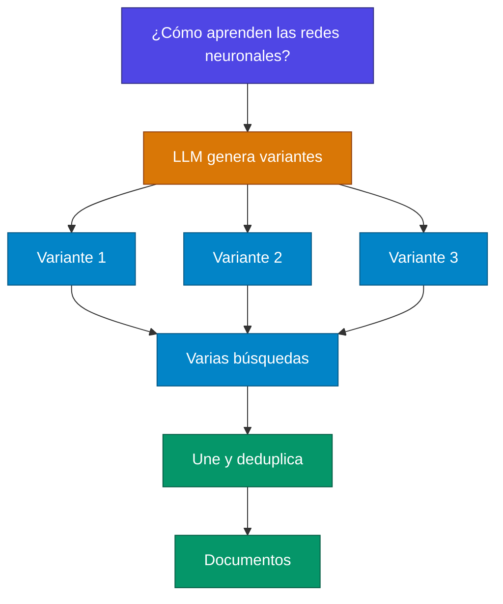
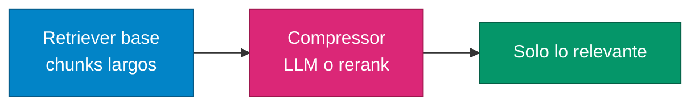
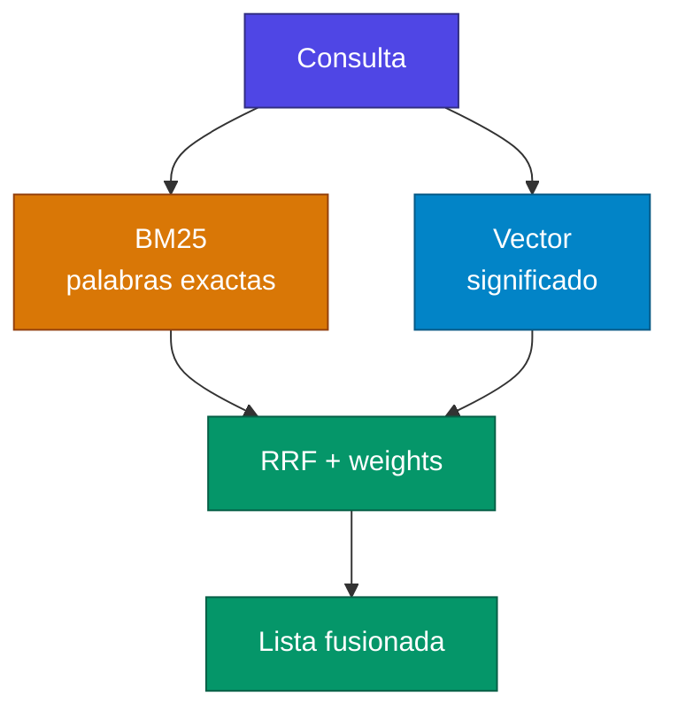
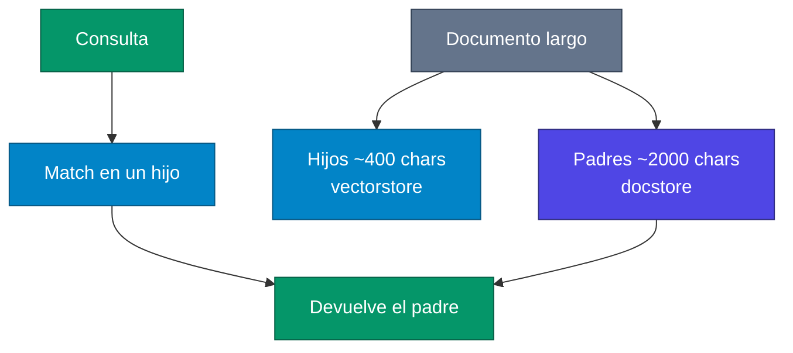

# Lectura: Retrievers interesantes en LangChain

Los retrievers constituyen el corazón de cualquier sistema RAG (Retrieval-Augmented Generation) exitoso. LangChain ha evolucionado para ofrecer una amplia gama de retrievers sofisticados que van mucho más allá de la simple búsqueda por similitud. En este artículo, exploraremos los retrievers más interesantes y potentes que están transformando la manera en que nuestras aplicaciones de IA acceden y procesan información.

> **Para aclarar RAG en una frase:** no le pides al LLM que “recuerde” tus PDFs. Primero **recuperas** trozos relevantes (`Document`) y luego se los pasas al modelo para que genere la respuesta con ese contexto.


---

## ¿Qué es un Retriever en LangChain?

Un retriever en LangChain es una interfaz que recibe una consulta en lenguaje natural y devuelve documentos relevantes. A diferencia de los vector stores, los retrievers no necesitan almacenar documentos, solo recuperarlos. Esta abstracción permite crear sistemas de recuperación flexibles y modulares que se adaptan a diferentes necesidades.

**Características clave:**

- Entrada: string de consulta
- Salida: lista de objetos Document
- Implementan la interfaz Runnable estándar
- Compatibles con LCEL (LangChain Expression Language)

> **Para aclarar vector store vs retriever:**
>
> | | Vector store | Retriever |
> | --- | --- | --- |
> | Guarda embeddings | Sí | No tiene por qué |
> | Interfaz típica | `similarity_search`, `add_documents` | `invoke("pregunta")` → `list[Document]` |
> | Relación | El almacén | Una **capa encima**: `vector_store.as_retriever()` |
>
> Un retriever puede usar un vector store, BM25, un LLM, o varios a la vez. Por eso LangChain los trata como `Runnable`: encajan en `retriever | prompt | llm`.
>
> En LangChain 1.x, varios de estos imports viven en `langchain_classic` (`MultiQueryRetriever`, `ContextualCompressionRetriever`, etc.), no en `langchain.retrievers`.



---

## 1. MultiQueryRetriever: La Perspectiva Múltiple

### ¿Qué hace?

El MultiQueryRetriever aborda las limitaciones de la búsqueda por similitud basada en distancia generando múltiples "perspectivas" alternativas de tu consulta original. En lugar de hacer una sola búsqueda, utiliza un LLM para crear varias versiones de la misma pregunta y luego combina los resultados.



### Implementación

```python
from langchain.retrievers.multi_query import MultiQueryRetriever
from langchain_openai import ChatOpenAI

# Configurar el retriever
llm = ChatOpenAI(temperature=0)
multi_query_retriever = MultiQueryRetriever.from_llm(
    retriever=vector_store.as_retriever(),
    llm=llm,
    verbose=True  # Ver las consultas generadas
)

# Una pregunta se convierte en múltiples perspectivas
results = multi_query_retriever.invoke("¿Cómo aprenden las redes neuronales?")
```

### Cuándo usarlo

- Cuando tu consulta original puede ser interpretada de múltiples formas
- Para mejorar la diversidad de resultados recuperados
- En casos donde la consulta inicial podría no capturar todos los aspectos relevantes

> **Para aclarar:** si escribes “redes neuronales”, el embedding puede no coincidir con un chunk que dice “backpropagation” o “descenso de gradiente”. El LLM reformula la pregunta y cada variante busca por su cuenta. Cuesta **más llamadas** (LLM + varias búsquedas), a cambio de más cobertura.

---

## 2. ContextualCompressionRetriever: El Filtro Inteligente

### ¿Qué problema resuelve?

Uno de los desafíos con la recuperación es que normalmente no conoces las consultas específicas que enfrentará tu sistema de almacenamiento de documentos cuando ingieres datos al sistema. Esto significa que la información más relevante para una consulta puede estar enterrada en un documento con mucho texto irrelevante.

> **Para aclarar:** el retriever base te da el **chunk entero**. Si el chunk tiene 800 palabras y solo 2 frases responden, esas 798 extra ocupan tokens y distraen al LLM. La compresión recorta o reescribe el documento **después** de recuperarlo, en función de la pregunta.



### Implementación

```python
from langchain.retrievers import ContextualCompressionRetriever
from langchain.retrievers.document_compressors import LLMChainExtractor

# Crear compresor que extrae solo contenido relevante
compressor = LLMChainExtractor.from_llm(llm)

compression_retriever = ContextualCompressionRetriever(
    base_compressor=compressor,
    base_retriever=vector_store.as_retriever()
)

# Solo obtener las partes relevantes
compressed_results = compression_retriever.invoke(
    "Explica el algoritmo de retropropagación"
)
```

### Pipeline avanzado de compresión

```python
from langchain.retrievers.document_compressors import DocumentCompressorPipeline
from langchain_community.document_transformers import EmbeddingsRedundantFilter
from langchain_text_splitters import CharacterTextSplitter

# Pipeline: dividir -> filtrar redundantes -> comprimir por relevancia
splitter = CharacterTextSplitter(chunk_size=300, chunk_overlap=0, separator=".")
redundant_filter = EmbeddingsRedundantFilter(embeddings=embeddings)
relevant_filter = LLMChainExtractor.from_llm(llm)

pipeline_compressor = DocumentCompressorPipeline(
    transformers=[splitter, redundant_filter, relevant_filter]
)
```

> **Para aclarar el pipeline:** no es un retriever nuevo. Es un **compresor compuesto** que puedes pasar como `base_compressor`. Orden típico: trocear → quitar casi-duplicados (embeddings parecidos) → extraer con el LLM lo que encaja con la query.

### Beneficios

- Reduce costos de llamadas a LLM al eliminar texto irrelevante
- Mejora la calidad de las respuestas al proporcionar contexto más preciso
- Permite pasar más documentos relevantes dentro del límite de tokens

> El primer LLM (el extractor) **sí cuesta**. El ahorro es en el LLM **final** de la respuesta, que recibe menos basura.

---

## 3. EnsembleRetriever: El Mejor de Dos Mundos

### La potencia del híbrido

El EnsembleRetriever soporta la combinación de resultados de múltiples retrievers. Los EnsembleRetrievers reordenan los resultados de los retrievers constituyentes basándose en el algoritmo de Fusión de Ranking Recíproco.

> **Para aclarar RRF (Fusión de Ranking Recíproco):** no promedia scores (BM25 y cosine no están en la misma escala). Mira **en qué puesto** salió cada documento en cada retriever y premia a los que quedan alto en varios rankings. `weights` inclina la balanza (aquí 30 % léxico, 70 % semántico).



### Implementación BM25 + Vector Search

```python
from langchain.retrievers import EnsembleRetriever
from langchain_community.retrievers import BM25Retriever
from langchain_community.vectorstores import FAISS
from langchain_openai import OpenAIEmbeddings

# Crear retriever BM25 (búsqueda por palabras clave)
bm25_retriever = BM25Retriever.from_documents(documents)
bm25_retriever.k = 5

# Crear retriever vectorial (búsqueda semántica)
embedding = OpenAIEmbeddings()
vectorstore = FAISS.from_documents(documents, embedding)
vector_retriever = vectorstore.as_retriever(search_kwargs={"k": 5})

# Combinar ambos con pesos
ensemble_retriever = EnsembleRetriever(
    retrievers=[bm25_retriever, vector_retriever],
    weights=[0.3, 0.7]  # 30% BM25, 70% vectorial
)
```

### Por qué es efectivo

- **BM25:** Excelente para coincidencias exactas de palabras clave
- **Vector Search:** Superior para similitud semántica
- **Fusión:** Combina las fortalezas de ambos enfoques

### Casos de uso ideales

- Búsquedas que requieren tanto precisión léxica como semántica
- Documentos técnicos con terminología específica
- Sistemas de búsqueda empresarial

---

## 4. ParentDocumentRetriever: Precisión con Contexto

### El equilibrio perfecto

El ParentDocumentRetriever logra ese equilibrio dividiendo y almacenando pequeños trozos de datos. Durante la recuperación, primero obtiene los trozos pequeños pero luego busca los IDs padre de esos trozos y devuelve esos documentos más grandes.



### Implementación

```python
from langchain.retrievers import ParentDocumentRetriever
from langchain.storage import InMemoryStore
from langchain_chroma import Chroma
from langchain_text_splitters import RecursiveCharacterTextSplitter

# Splitter para documentos padre (chunks grandes)
parent_splitter = RecursiveCharacterTextSplitter(chunk_size=2000)

# Splitter para documentos hijo (chunks pequeños para embedding)
child_splitter = RecursiveCharacterTextSplitter(chunk_size=400)

# Vector store para los chunks pequeños
vectorstore = Chroma(
    collection_name="parent_docs",
    embedding_function=OpenAIEmbeddings()
)

# Almacenamiento para documentos padre
store = InMemoryStore()

retriever = ParentDocumentRetriever(
    vectorstore=vectorstore,
    docstore=store,
    child_splitter=child_splitter,
    parent_splitter=parent_splitter,
)

# Agregar documentos
retriever.add_documents(documents)
```

### Ventajas clave

- **Embeddings precisos:** Los chunks pequeños crean embeddings más representativos
- **Contexto completo:** Devuelve documentos padre con contexto suficiente
- **Flexibilidad:** Puedes ajustar el tamaño de chunks padre e hijo independientemente

> **Para aclarar el problema que resuelve:** chunk pequeño = búsqueda fina, pero al LLM le falta contexto. Chunk grande = contexto, pero el embedding se “diluye”. Aquí se **busca** en hijos y se **entrega** el padre. `InMemoryStore` se pierde al cerrar el proceso; en producción haría falta un store persistente.

---

## 5. SelfQueryRetriever: Búsqueda Estructurada Inteligente

### Más allá de la similitud semántica

SelfQueryRetriever utilizará un LLM para generar una consulta que es potencialmente estructurada, por ejemplo, puede construir filtros para la recuperación además de la selección habitual dirigida por similitud semántica.

> **Para aclarar:** “películas de ciencia ficción de después de 2010 con calificación alta” se parte en:
>
> 1. Búsqueda semántica sobre el resumen.
> 2. Filtros de metadata: `genre`, `year > 2010`, `rating` alto.
>
> Sin esto, el vector store no entiende “después de 2010” como un filtro numérico. `AttributeInfo` es el esquema que el LLM usa para no inventar campos.


### Implementación

```python
from langchain.chains.query_constructor.base import AttributeInfo
from langchain.retrievers.self_query.base import SelfQueryRetriever

# Definir metadatos de los documentos
metadata_field_info = [
    AttributeInfo(
        name="genre",
        description="El género de la película",
        type="string"
    ),
    AttributeInfo(
        name="year",
        description="El año de lanzamiento de la película",
        type="integer"
    ),
    AttributeInfo(
        name="rating",
        description="La calificación de la película (1-10)",
        type="float"
    ),
]

document_content_description = "Breve resumen de una película"

retriever = SelfQueryRetriever.from_llm(
    llm=ChatOpenAI(temperature=0),
    vectorstore=vectorstore,
    document_content_description=document_content_description,
    metadata_field_info=metadata_field_info,
)

# Consulta que se convertirá en filtros estructurados
results = retriever.invoke("películas de ciencia ficción de después de 2010 con calificación alta")
```

### Casos de uso

- Bases de datos con metadatos ricos
- Consultas que combinan contenido y filtros
- Sistemas que requieren búsqueda estructurada automática

---

## 6. TimeWeightedVectorStoreRetriever: Memoria que Desvanece

### Para información sensible al tiempo

Este retriever asigna mayor importancia a documentos más recientes, simulando cómo funciona la memoria humana.

```python
from langchain.retrievers import TimeWeightedVectorStoreRetriever
from datetime import datetime, timedelta

tw_retriever = TimeWeightedVectorStoreRetriever(
    vectorstore=vectorstore,
    decay_rate=0.999,  # Qué tan rápido "olvida" documentos antiguos
    k=5
)

# Los documentos más antiguos tendrán menos peso
yesterday = datetime.now() - timedelta(days=1)
tw_retriever.add_documents([Document(page_content="Noticia vieja")], timestamps=[yesterday])
tw_retriever.add_documents([Document(page_content="Noticia nueva")])
```

> **Para aclarar `decay_rate`:** el score mezcla similitud **y** antigüedad. Cerca de `1.0` olvida despacio; más bajo, las noticias viejas caen antes. Útil en agentes con “memoria” o feeds de noticias, no tanto en un manual que no caduca.

---

## 7. Técnicas Avanzadas y Combinaciones

### Retrieval con Reranking

```python
from langchain.retrievers.document_compressors import CohereRerank

# Primer pase: recuperar muchos documentos
base_retriever = vectorstore.as_retriever(search_kwargs={"k": 20})

# Segundo pase: reordenar con Cohere
reranker = CohereRerank(
    model="rerank-multilingual-v2.0",
    top_n=5
)

compression_retriever = ContextualCompressionRetriever(
    base_compressor=reranker,
    base_retriever=base_retriever
)
```

> **Para aclarar retrieve-then-rerank:** primero barato y amplio (`k=20`). Luego un modelo de rerank (aquí Cohere) puntúa *query + documento* y se queda `top_n=5`. Suele mejorar más que subir `k` a secas. Requiere API de Cohere.


### Retrieval MMR (Maximum Marginal Relevance)

```python
# Balancear relevancia con diversidad
mmr_retriever = vectorstore.as_retriever(
    search_type="mmr",
    search_kwargs={
        "k": 10,
        "lambda_mult": 0.7  # Balance entre relevancia (1.0) y diversidad (0.0)
    }
)
```

> **Para aclarar MMR:** la búsqueda por similitud pura a veces te da 10 chunks casi iguales. MMR elige el siguiente chunk **parecido a la query y distinto de los ya elegidos**. `lambda_mult=1.0` = solo relevancia; `0.0` = máxima diversidad.

---

## Conclusión

Los retrievers de LangChain han evolucionado significativamente, ofreciendo soluciones especializadas para cada desafío de recuperación de información. La clave del éxito está en:

- Entender tu caso de uso: Cada retriever tiene fortalezas específicas
- Experimentar con combinaciones: Los mejores sistemas suelen combinar múltiples técnicas
- Evaluar constantemente: La calidad de recuperación impacta directamente en la experiencia del usuario
- Optimizar para producción: Considera latencia, costos y escalabilidad

El ecosistema de retrievers de LangChain seguirá evolucionando, pero dominar estos conceptos fundamentales te dará una base sólida para construir aplicaciones RAG verdaderamente efectivas.

¿Qué retriever vas a implementar primero en tu próximo proyecto? La elección correcta puede marcar la diferencia entre una aplicación que funciona y una que realmente sobresale.

> **Brújula rápida (añadida):**
>
> | Retriever | Idea en una línea |
> | --- | --- |
> | MultiQuery | Varias reformulaciones de la misma pregunta |
> | Compression | Recorta el chunk a lo que importa |
> | Ensemble | BM25 + vectores (u otros) con RRF |
> | ParentDocument | Busca fino, devuelve el bloque grande |
> | SelfQuery | Filtros de metadata generados por el LLM |
> | TimeWeighted | Premia lo reciente |
> | Rerank | Muchos candidatos, luego reordena |
> | MMR | Relevancia + diversidad |
