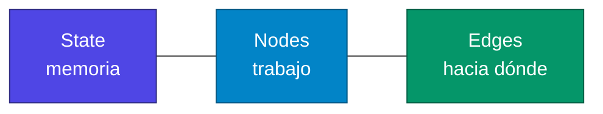
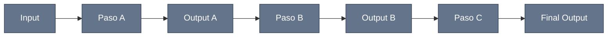
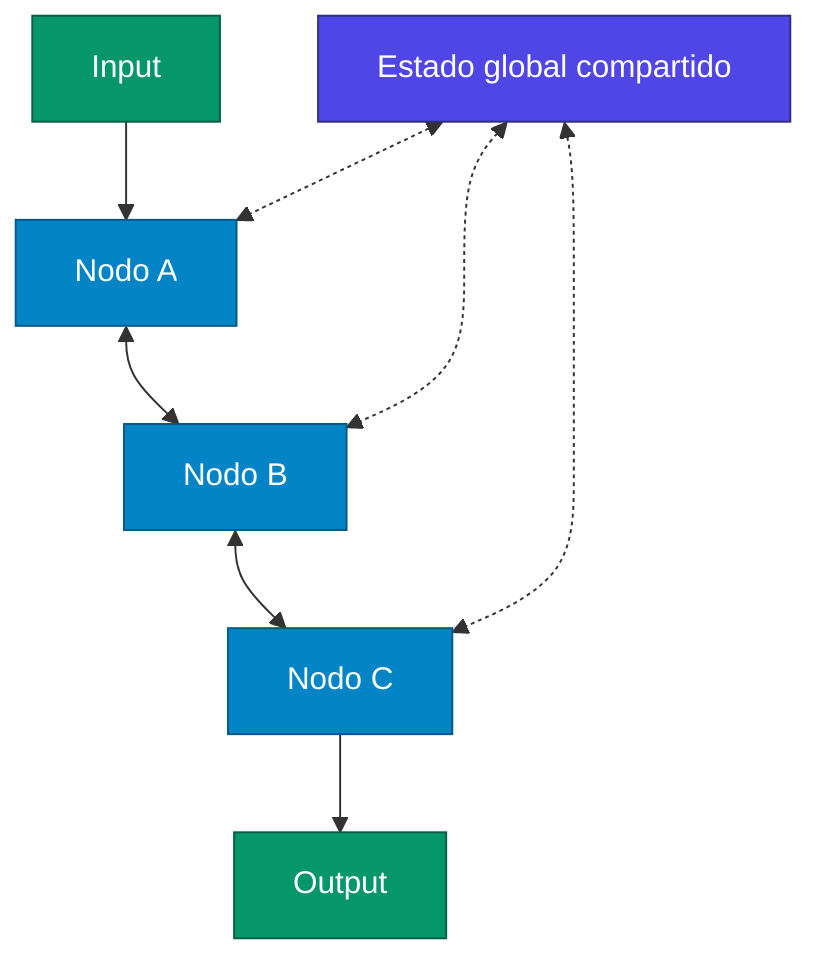
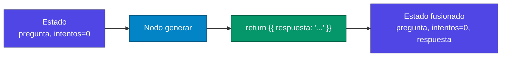
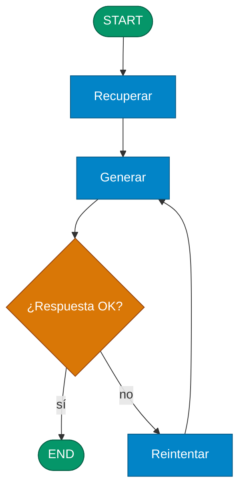

# Lectura: Componentes fundamentales de LangGraph

## Fundamentos de LangGraph: State, Nodes y Edges Explicados

LangGraph representa una evolución natural en la construcción de aplicaciones de IA complejas. Mientras que las chains lineales de LangChain nos permitieron crear flujos secuenciales básicos, LangGraph introduce un paradigma completamente nuevo basado en grafos que nos habilita a construir workflows verdaderamente sofisticados y adaptativos.

En este artículo, exploraremos los tres componentes fundamentales que hacen de LangGraph una herramienta tan poderosa: State (Estado), Nodes (Nodos) y Edges (Aristas). Comprender estos conceptos es esencial para aprovechar al máximo las capacidades de LangGraph en tus aplicaciones de IA.

> **Para aclarar:** una *chain* (`prompt | llm | parser`) es un tubo: A sale hacia B, B hacia C. Un *grafo* puede **volver atrás**, **ramificar** y **compartir memoria**. Eso son State + Nodes + Edges.



---

## El Paradigma del StateGraph

Antes de profundizar en los componentes individuales, es crucial entender el concepto central que los unifica: el StateGraph.

Un StateGraph es un tipo especial de grafo donde todos los nodos comparten un estado mutable común. Esto representa un cambio fundamental respecto a las arquitecturas tradicionales:

**Arquitectura Chain Lineal:**

```
Input → Paso A → Output A → Paso B → Output B → Paso C → Final Output
```



**StateGraph de LangGraph:**

```
                    Estado Global Compartido
                      ↕        ↕        ↕
Input → Nodo A ←→ Nodo B ←→ Nodo C ←→ Output
```



Esta diferencia arquitectónica permite funcionalidades avanzadas como memoria persistente, acumulación de resultados y flujos de control complejos con loops y ramificaciones condicionales.

> **Para aclarar:** en la chain, si el paso C necesita algo del paso A que B no reenvió, se perdió. En el StateGraph, A escribe `pregunta` en el estado; C lo lee aunque B no lo toque.

---

## 1. State (Estado): La Memoria Compartida del Grafo

### ¿Qué es el State?

El State es la información compartida y persistente a lo largo de todo el grafo. Piensa en él como una "base de datos" común donde todos los nodos pueden leer y escribir información de manera colaborativa.

A diferencia de una chain lineal donde cada paso produce una salida que es la entrada del siguiente, en LangGraph todos los nodos pueden acceder y modificar un estado global común. Esto proporciona una flexibilidad extraordinaria para manejar información compleja y flujos de trabajo no lineales.

### Características clave del State

- **Global y Accesible:** Todos los nodos del grafo pueden leer cualquier información almacenada en el estado. Esto elimina la necesidad de pasar datos explícitamente entre nodos.

- **Mutable y Evolutivo:** El estado se actualiza a medida que los nodos ejecutan. Cada nodo puede modificar parcial o totalmente el diccionario de estado según sus necesidades.

- **Tipado y Estructurado:** Se define mediante esquemas claros (como TypedDict o dataclass) que especifican las claves y tipos de datos que contendrá. Esto proporciona claridad sobre qué información está disponible.

- **Flexible:** Permite compartir datos complejos entre diferentes partes del workflow, desde strings simples hasta objetos complejos, listas de mensajes, resultados de búsquedas, etc.

### El Estado como Contrato

El estado actúa como un "contrato" entre todos los nodos del grafo. Cuando definimos el esquema del estado, estamos estableciendo:

- Qué campos estarán disponibles
- Qué tipo de datos contendrá cada campo
- Cómo los nodos pueden interactuar con esa información

Por ejemplo, podríamos definir un estado con campos como `pregunta: str`, `respuesta: str`, `intentos: int`, `documentos_relevantes: List[str]`, etc. Esto da a todos los nodos una comprensión clara de qué información pueden esperar y cómo pueden contribuir.

> **Para aclarar:** el contrato suele ser un `TypedDict`. No es una base de datos real: es un diccionario que LangGraph pasa de nodo en nodo. Si un campo no está en el esquema, no deberías inventártelo en un return.

```python
from typing import TypedDict, List

class Estado(TypedDict):
    pregunta: str
    respuesta: str
    intentos: int
    documentos_relevantes: List[str]
```

### Ventajas del State Compartido

- **Memoria de Conversación:** Mantiene el contexto completo entre diferentes pasos del workflow, permitiendo conversaciones naturales y coherentes.

- **Acumulación de Resultados:** Permite que múltiples nodos contribuyan información complementaria que se va construyendo gradualmente.

- **Decisiones Informadas:** Los nodos posteriores pueden tomar decisiones basadas en toda la información acumulada por nodos anteriores.

- **Flexibilidad de Flujo:** No requiere predefinir todas las conexiones entrada-salida, permitiendo workflows más dinámicos y adaptativos.

---

## 2. Nodes (Nodos): Las Unidades de Trabajo

### ¿Qué es un Nodo?

Un Nodo es la unidad básica de trabajo en LangGraph. Representa una acción o tarea atómica que puede leer del estado global y contribuir actualizaciones específicas al mismo.

La filosofía detrás de los nodos es simple pero poderosa: cada nodo es una función que recibe el estado completo como entrada y devuelve un diccionario parcial con las actualizaciones que quiere aplicar al estado.

### La Firma de un Nodo: State → PartialState

Esta es la característica más importante de entender sobre los nodos: no devuelven un estado completo, solo devuelven las partes del estado que ellos modifican.

LangGraph se encarga automáticamente de:

- Pasar el estado completo al nodo
- Recibir las actualizaciones parciales del nodo
- Fusionar esas actualizaciones con el estado global
- Propagar el estado actualizado al siguiente nodo

Esto significa que cada nodo puede enfocarse únicamente en su tarea específica sin preocuparse por mantener o propagar información que no le concierne.



> **Para aclarar:** si el nodo de generación solo hace `return {"respuesta": texto}`, `pregunta` e `intentos` **siguen ahí**. LangGraph hace un merge, no un reemplazo total del estado. Devolver el estado entero a mano suele ser un error de diseño.

```python
def generar(estado: Estado) -> dict:
    # lee todo lo que necesite
    pregunta = estado["pregunta"]
    # solo escribe lo que cambia
    return {"respuesta": "..."}
```

### Tipos Conceptuales de Nodos

- **Nodos de Procesamiento:** Realizan transformaciones sobre datos existentes en el estado. Por ejemplo, un nodo que procesa resultados de búsqueda o que analiza el sentimiento de un texto.

- **Nodos de Generación:** Crean nuevo contenido, típicamente usando LLMs. Por ejemplo, un nodo que genera una respuesta basada en documentos recuperados.

- **Nodos de Recuperación:** Obtienen información externa y la añaden al estado. Por ejemplo, un nodo que busca información en bases de datos o APIs externas.

- **Nodos de Decisión:** Evalúan condiciones y pueden modificar flags o contadores en el estado que luego influencian el flujo de ejecución.

- **Nodos de Validación:** Verifican la calidad o corrección de información en el estado y pueden añadir métricas de confianza o indicadores de validez.

### Principios de Diseño de Nodos

- **Responsabilidad Única:** Cada nodo debe tener un propósito claro y específico. Un nodo que hace "demasiadas cosas" es difícil de debuggear y reutilizar.

- **Atomicidad:** Los nodos deben representar tareas atómicas que se pueden ejecutar de manera independiente y completa.

- **Actualizaciones Mínimas:** Solo deben devolver las claves del estado que realmente modifican, no todo el estado.

- **Determinismo:** Idealmente, ejecutar el mismo nodo con el mismo estado debería producir el mismo resultado (cuando sea posible).

---

## 3. Edges (Aristas): El Control de Flujo

### ¿Qué son los Edges?

Los Edges son las conexiones dirigidas entre nodos que determinan el orden de ejecución y el flujo de control del grafo. Son fundamentalmente diferentes a las simples "tuberías" entre funciones porque pueden ser condicionales y dinámicos.

### Tipos de Edges

- **Edges Normales (Fijos):** Representan conexiones determinísticas que siempre dirigen el flujo de un nodo específico a otro. Son útiles para secuencias de pasos que siempre deben ejecutarse en orden.

- **Edges Condicionales:** Permiten ramificación dinámica basada en el estado actual. Una función de decisión examina el estado y determina cuál debe ser el próximo nodo a ejecutar. Esto es lo que hace posible workflows realmente inteligentes y adaptativos.



> **Para aclarar:** el edge fijo es `add_edge("recuperar", "generar")` (siempre). El condicional es `add_conditional_edges("generar", decidir)` donde `decidir(estado)` devuelve el **nombre** del siguiente nodo (`"end"` o `"reintentar"`). La decisión lee el State; no “adivina” el grafo.

### Nodos Especiales: START y END

- **START:** Es el punto de entrada del grafo. No ejecuta lógica propia, simplemente recibe el estado inicial que proporcionamos al invocar el grafo.

- **END:** Es el punto de terminación del grafo. Indica que el workflow ha completado exitosamente y devuelve el estado final.

Estos nodos especiales proporcionan puntos de anclaje claros para el flujo de ejecución y hacen que el grafo sea más fácil de entender y debuggear.

### Control de Flujo Avanzado

Los edges condicionales son donde LangGraph realmente brilla. Permiten implementar lógica de control sofisticada como:

- **Bucles de Retry:** Si un nodo no produce un resultado satisfactorio, el flujo puede volver a ejecutar nodos anteriores.

- **Ramificación Basada en Calidad:** Diferentes caminos de ejecución según la calidad o confianza de los resultados.

- **Escalamiento Gradual:** Intentar métodos simples primero, y escalar a métodos más complejos o costosos si es necesario.

- **Paralelización Condicional:** Ejecutar diferentes ramas del grafo en paralelo según las condiciones del estado.

---

## Consideraciones de Diseño

### Planificación del Estado

El diseño del estado es crucial. Debes planificar cuidadosamente qué información necesitará estar disponible, cómo evolucionará a lo largo del workflow, y cómo evitar conflictos cuando múltiples nodos escriben información relacionada.

### Gestión de Complejidad

Aunque LangGraph permite workflows muy complejos, es importante mantener un equilibrio. Un grafo demasiado complejo puede volverse difícil de entender, debuggear y mantener.

### Funciones Reducer

Cuando múltiples nodos pueden escribir en las mismas claves del estado, LangGraph usa funciones "reducer" para determinar cómo combinar las actualizaciones. Entender este concepto es crucial para workflows avanzados. (Lo veremos en las siguientes clases)

> **Para aclarar (adelanto):** si dos nodos hacen `return {"documentos": [...]}`, ¿se pisan o se concatenan? El reducer decide. Lo habitual en listas de mensajes es `add` (acumular), no sustituir. Sin reducer, la última escritura gana.

---

## Conclusión

Los componentes fundamentales de LangGraph (State, Nodes y Edges) trabajan juntos para crear un paradigma poderoso y flexible que va mucho más allá de las chains lineales tradicionales.

**Conceptos clave para recordar:**

- **State** actúa como memoria compartida y persistente entre todos los nodos
- **Nodes** encapsulan lógica específica y solo devuelven actualizaciones parciales del estado
- **Edges** proporcionan control de flujo inteligente con capacidades condicionales
- **StateGraph** habilita workflows no-lineales, adaptativos y con memoria

Esta arquitectura conceptual abre la puerta a aplicaciones de IA verdaderamente sofisticadas que pueden:

- Adaptar su comportamiento dinámicamente
- Mantener contexto complejo a largo plazo
- Manejar flujos de trabajo iterativos y de refinamiento
- Implementar lógica de decisión compleja basada en múltiples factores

En los siguientes videos del curso, veremos cómo estos conceptos se traducen en código práctico y construiremos juntos workflows reales que demuestran el poder de este paradigma.

¿Estás comenzando a visualizar las posibilidades? La verdadera magia de LangGraph emerge cuando estos conceptos fundamentales se combinan con las capacidades avanzadas que exploraremos en las próximas lecciones.
