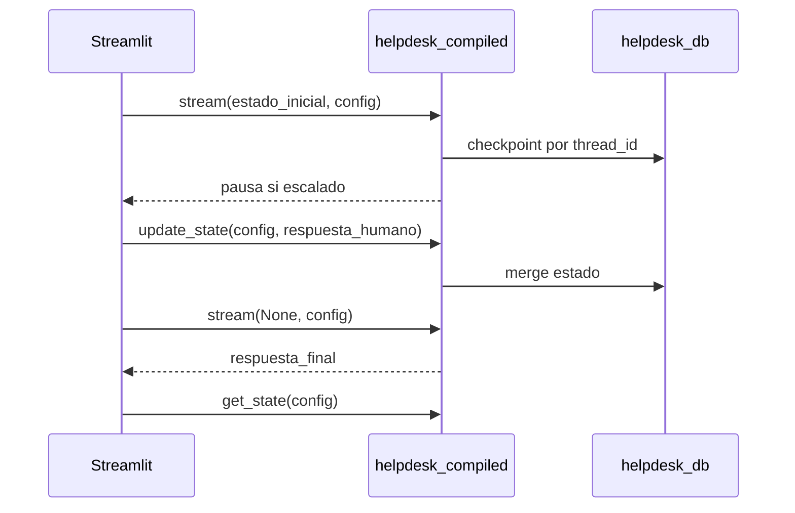

# Notas LangGraph — Tema 4

Referencia rápida para `config`, threads, checkpointer y human-in-the-loop. El ejemplo completo está en [`helpdesk_system/`](helpdesk_system/).

---

## El `config` y `thread_id`

Con checkpointer, **cada ejecución** debe pasar un `config` con esta forma (nombres fijos de la API):

```python
config = {"configurable": {"thread_id": "TK-ABC123"}}
```

- **`configurable`**: bucket de LangGraph para parámetros de runtime (no inventar `conf`, `id`, etc.).
- **`thread_id`**: identifica la conversación/ticket en el checkpointer (clave en `helpdesk.db`).

Documentación: [Checkpointers — Threads](https://docs.langchain.com/oss/python/langgraph/checkpointers#threads)

Mismo `thread_id` → reanudar el mismo ticket. `thread_id` nuevo → run independiente.

---

## Grafos sin persistencia

Scripts como `primer_programa_langgraph.py`, `control_flujo_laggraph.py`, `procesador_reuniones_langgraph.py` y `annotated_types_langgraph.py` usan:

```python
compiled = graph.compile()  # sin checkpointer
```

Cada `invoke()` empieza de cero. No hace falta `config` ni `thread_id`.

---

## Grafos con persistencia (helpdesk)

En [`helpdesk_system/graph.py`](helpdesk_system/graph.py):

```python
compiled = graph.compile(
    checkpointer=SqliteSaver(conn),
    interrupt_before=["procesar_humano"],
)
```

- **`SqliteSaver`**: paquete `langgraph-checkpoint-sqlite`; guarda en `helpdesk.db`.
- **`interrupt_before`**: pausa antes del nodo indicado (human-in-the-loop).

Documentación: [Checkpointers](https://docs.langchain.com/oss/python/langgraph/checkpointers) · [Interrupts](https://docs.langchain.com/oss/python/langgraph/interrupts) · [Persistence](https://docs.langchain.com/oss/python/langgraph/persistence)

---

## Flujo human-in-the-loop (helpdesk)



1. **`stream(estado_inicial, config=...)`** — primera corrida; guarda checkpoints.
2. Si escala → grafo para; `respuesta_humano` sigue vacío.
3. **`update_state(config, {"respuesta_humano": ...})`** — la UI inyecta la respuesta en el checkpoint (método de LangGraph, no definido en tu código).
4. **`stream(None, config=...)`** — reanuda con el **mismo** `config`.
5. **`get_state(config)`** — lee el `HelpdeskState` persistido.

---

## Métodos usados en este proyecto

| Método | Archivo | Para qué |
| --- | --- | --- |
| `compile(checkpointer=...)` | `helpdesk_system/graph.py` | Habilitar persistencia |
| `compile()` sin args | resto Tema 4 | Grafo stateless |
| `stream(..., config=, stream_mode="updates")` | `helpdesk_system/app.py` | Ejecutar y ver salida por nodo |
| `get_state(config)` | `helpdesk_system/app.py` | Leer estado guardado |
| `update_state(config, dict)` | `helpdesk_system/app.py` | Escribir en checkpoint desde la UI |

Enlaces:

- [Streaming](https://docs.langchain.com/oss/python/langgraph/streaming)
- [Graph API — State](https://docs.langchain.com/oss/python/langgraph/graph-api)
- [Interrupts — Modifying state](https://docs.langchain.com/oss/python/langgraph/interrupts)

---

## Reducers (`Annotated[..., add]`)

En `HelpdeskState`, `historial: Annotated[List[str], add]` acumula entradas en lugar de reemplazar la lista. Ver `annotated_types_langgraph.py` y [Graph API](https://docs.langchain.com/oss/python/langgraph/graph-api).

---

## Enlaces oficiales

- [Overview LangGraph](https://docs.langchain.com/oss/python/langgraph/overview)
- [Checkpointers](https://docs.langchain.com/oss/python/langgraph/checkpointers)
- [Persistence](https://docs.langchain.com/oss/python/langgraph/persistence)
- [Interrupts / HITL](https://docs.langchain.com/oss/python/langgraph/interrupts)
- [Índice completo](https://docs.langchain.com/llms.txt)
