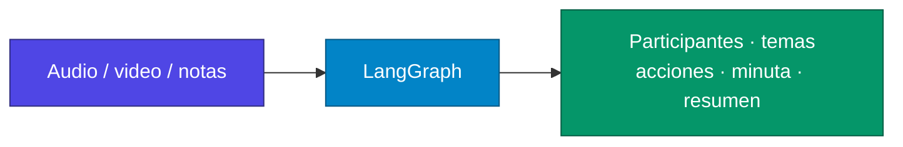
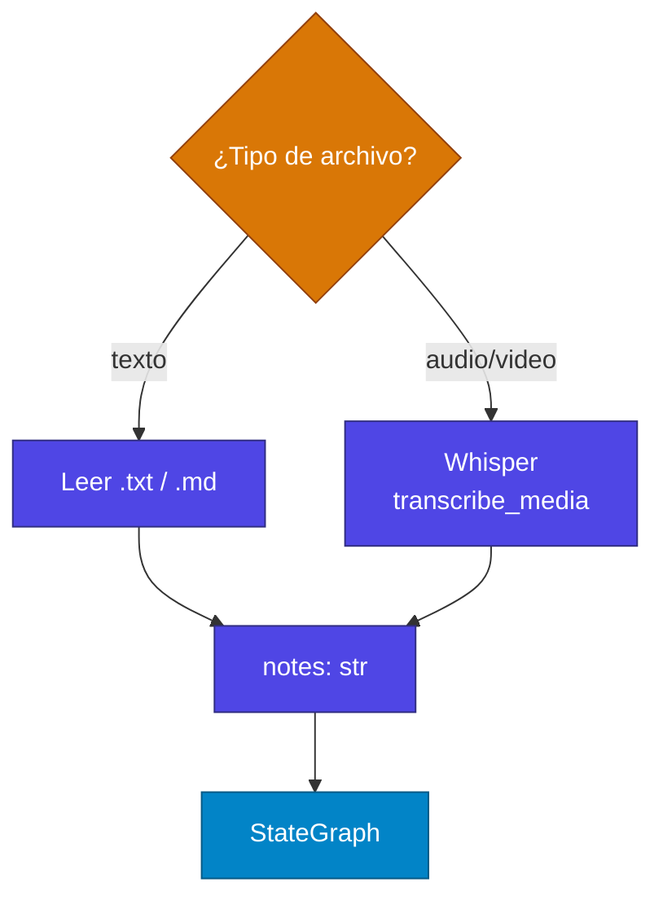

# Proyecto: Sistema de Procesamiento de Reuniones con IA y LangGraph

A continuación te vas a enfrentar a uno de los desafíos más complejos del curso hasta el momento. Para este proyecto, asumiré que eres un ingeniero de IA trabajando en una empresa tecnológica y has recibido el encargo de desarrollar una aplicación de procesamiento automático de reuniones que cumpla con la siguiente especificación técnica. Este ejercicio te permitirá aplicar todo el conocimiento adquirido sobre LangGraph y arquitectura de workflows en un contexto profesional. Encontrarás la resolución en la siguiente clase.

---

## Objetivos del Proyecto

Desarrollar un sistema de procesamiento automático que transforme grabaciones de reuniones o notas desordenadas en documentación empresarial estructurada utilizando LangGraph y modelos de lenguaje.

**Nota importante:** Este es un proyecto de complejidad considerable. No se espera una implementación completa, sino un enfoque metodológico en el diseño de la solución. El objetivo principal es desarrollar capacidades de pensamiento arquitectónico y comprensión de workflows con LangGraph. La solución completa se presentará en el material complementario.

> **Para aclarar qué se evalúa aquí:** no hace falta una app de producción. Sí hace falta un **State** bien pensado, **nodos con una sola responsabilidad** y un **flujo** que respete dependencias (participantes → temas → acciones → minuta → resumen).



---

## Descripción del Sistema

### Entradas del Sistema

El sistema debe procesar dos tipos de entrada:

- **Archivos multimedia:** Video y audio de reuniones (MP4, MOV, MP3, WAV, M4A, WEBM, MKV)
- **Documentos de texto:** Notas escritas en formato TXT o Markdown

> **Para aclarar:** el grafo **siempre trabaja con texto** (`notes: str`). Si llega un MP4, Whisper lo convierte a texto *antes* de `START`. El workflow no “escucha” el audio.

### Salidas Estructuradas

Para cada entrada, el sistema debe generar:

- Lista identificada de participantes
- Temas principales discutidos (3-5 elementos)
- Acciones acordadas con responsables asignados
- Minuta formal de reunión (máximo 150 palabras)
- Resumen ejecutivo conciso (máximo 30 palabras)

---

## Arquitectura del Workflow

### Consideraciones de Diseño

Antes de implementar, analice las siguientes cuestiones arquitectónicas:

- **Modularidad del Proceso:** ¿Debería implementarse como un único prompt o como múltiples nodos especializados? Considere las ventajas de la especialización versus la simplicidad.

- **Secuenciación de Operaciones:** Determine el orden óptimo de procesamiento. ¿Es necesario extraer participantes antes que temas? ¿Qué dependencias existen entre las diferentes extracciones de información?

- **Gestión del Estado:** ¿Cómo debe estructurarse la información que fluye entre los diferentes nodos del workflow? ¿Qué campos son necesarios y cuáles opcionales?

- **Robustez del Sistema:** ¿Cómo manejaría casos donde la información está incompleta o es ambigua? ¿Qué estrategias implementaría para inputs de baja calidad?

> **Para orientar esas cuatro preguntas (sin sustituir tu diseño):**
>
> | Pregunta | Pista |
> | --- | --- |
> | ¿Un prompt o cinco nodos? | Un prompt es más simple; cinco nodos se debuggean y reusan mejor (el enunciado pide cinco). |
> | ¿Orden? | La minuta y el resumen **necesitan** participantes, temas y acciones. Extraer nombres antes ayuda a asignar responsables. |
> | ¿Estado? | El `TypedDict` de abajo es el contrato: cada nodo solo rellena *sus* claves. |
> | ¿Input pobre? | Listas vacías, “no identificado”, o un nodo de validación; no inventar nombres. |

### Estado del Sistema

```python
class State(TypedDict):
    notes: str              # Texto original de entrada
    participants: List[str] # Participantes identificados
    topics: List[str]       # Temas principales
    action_items: List[str] # Acciones y responsables
    minutes: str            # Minuta formal
    summary: str            # Resumen ejecutivo
```

> **Para aclarar el State:** `notes` entra al inicio y **no hace falta que ningún nodo lo reescriba**. Cada extractor devuelve solo su campo (`{'participants': [...]}`). LangGraph fusiona. `minutes` y `summary` se generan al final leyendo lo ya acumulado.

---

## Nodos del Workflow

El sistema debe implementar cinco nodos especializados:

### 1. Extractor de Participantes

- **Responsabilidad:** Identificar nombres de personas en el texto
- **Desafío técnico:** Distinguir nombres propios de otros términos
- **Formato de salida:** Lista de nombres separados por comas

### 2. Analizador de Temas

- **Responsabilidad:** Identificar temas principales de discusión
- **Desafío técnico:** Evitar categorías demasiado generales o específicas
- **Formato de salida:** Temas separados por punto y coma

### 3. Extractor de Acciones

- **Responsabilidad:** Localizar compromisos y asignaciones de responsabilidad
- **Desafío técnico:** Identificar acciones implícitas versus explícitas
- **Formato de salida:** Acciones separadas por pipe (`|`)

### 4. Generador de Minutas

- **Responsabilidad:** Crear documento formal estructurado
- **Input:** Información procesada de nodos anteriores
- **Restricciones:** Máximo 150 palabras, tono profesional

### 5. Creador de Resumen

- **Responsabilidad:** Generar síntesis ejecutiva ultra-concisa
- **Input:** Toda la información procesada
- **Restricciones:** Máximo 30 palabras, enfoque en puntos clave

> **Para aclarar formatos:** el LLM a menudo responde *texto* (`"Ana, Luis"`). El nodo **parsea** a `List[str]` antes de escribir en el State. La minuta y el resumen sí se quedan como `str`.

---

## Flujo de Procesamiento

```
START → extract_participants → identify_topics → extract_actions → generate_minutes → create_summary → END
```


En este enunciado el flujo es **lineal** (edges fijos). No hace falta un edge condicional para cumplir la spec; podrías añadir retry más adelante.

---

## Especificaciones Técnicas

### Stack Tecnológico

```python
from langgraph.graph import StateGraph, START, END
from langchain_openai import ChatOpenAI
from typing import TypedDict, List
import openai  # Para transcripción Whisper
from tkinter import filedialog
```

### Configuración del Modelo

```python
llm = ChatOpenAI(model="gpt-4o-mini", temperature=0.3)
```

> **Para aclarar `temperature=0.3`:** extraer nombres y acciones conviene **poco creativo**. 0.3 reduce inventar participantes que no estaban en las notas.

### Procesamiento de Audio/Video

Para archivos multimedia, implemente transcripción utilizando la API Whisper de OpenAI:

```python
def transcribe_media(file_path: str) -> str:
    client = openai.OpenAI()
    with open(file_path, "rb") as audio_file:
        transcript = client.audio.transcriptions.create(
            model="whisper-1",
            file=audio_file,
            language="es",
            response_format="text"
        )
    return transcript
```

> **Para aclarar:** esta función **no es un nodo** del grafo. Es preproceso: archivo → `notes`. Luego `app.invoke({..., "notes": transcript})`. Whisper usa el mismo tipo de API key que ChatOpenAI (`OPENAI_API_KEY`).



---

## Guía de Implementación

### Fase 1: Estructura Básica

- Defina la clase State con todos los campos requeridos
- Configure el grafo básico de LangGraph sin lógica de negocio
- Implemente un nodo de prueba que procese texto hardcodeado
- Verifique que el flujo end-to-end funcione correctamente

### Fase 2: Nodos Especializados

- Desarrolle prompts específicos para cada tipo de extracción
- Implemente la lógica de procesamiento de respuestas del LLM
- Conecte todos los nodos en el flujo secuencial definido
- Pruebe con datos de ejemplo para validar la calidad de outputs

### Fase 3: Integración Completa

- Añada capacidad de procesamiento de archivos de texto
- Integre la transcripción de archivos multimedia
- Implemente interfaz de selección de archivos
- Añada manejo de errores y casos edge

> **Para aclarar el orden de las fases:** Fase 1 = el grafo “respira” (aunque el nodo sea un stub). Fase 2 = calidad de cada extracción. Fase 3 = archivos reales y `filedialog`. No empieces por Whisper si el `invoke` con texto hardcodeado aún no corre.

---

## Plantilla de Código

```python
from langgraph.graph import StateGraph, START, END
from langchain_openai import ChatOpenAI
from typing import TypedDict, List

llm = ChatOpenAI(model="gpt-4o-mini", temperature=0.3)

class State(TypedDict):
    notes: str
    participants: List[str]
    topics: List[str]
    action_items: List[str]
    minutes: str
    summary: str

def extract_participants(state: State) -> State:
    prompt = f"""
    Analiza las siguientes notas de reunión y extrae únicamente los nombres de los participantes.

    Notas: {state['notes']}

    Instrucciones:
    - Responde SOLO con nombres separados por comas
    - No incluyas explicaciones adicionales
    - Formato: Juan García, María López, Carlos Ruiz
    """

    response = llm.invoke(prompt)
    participants = [p.strip() for p in response.content.split(',') if p.strip()]

    return {'participants': participants}

def create_workflow():
    workflow = StateGraph(State)
    workflow.add_node("extract_participants", extract_participants)
    # Añadir resto de nodos

    workflow.add_edge(START, "extract_participants")
    # Definir resto del flujo

    return workflow.compile()

if __name__ == "__main__":
    app = create_workflow()

    test_state = {
        'notes': "Reunión con Juan García y María López sobre el proyecto...",
        'participants': [],
        'topics': [],
        'action_items': [],
        'minutes': '',
        'summary': ''
    }

    result = app.invoke(test_state)
    print(result)
```

> **Para aclarar la plantilla:** `extract_participants` está anotado `-> State` pero **devuelve un dict parcial** (`{'participants': ...}`), que es lo correcto en LangGraph. Replica el mismo patrón en los otros cuatro nodos: prompt estricto → parsear → `return {clave: valor}`.
>
> Los `# Añadir resto de nodos` / `# Definir resto del flujo` son huecos a propósito: `add_node` + `add_edge` para `identify_topics`, `extract_actions`, `generate_minutes`, `create_summary`.
