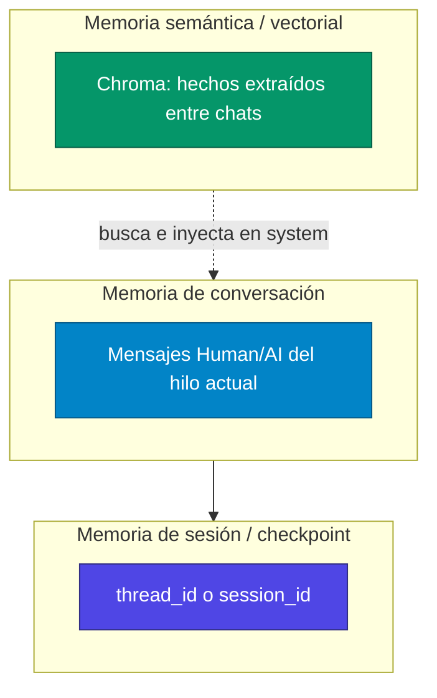

# Notas de memoria — Tema 5

Mapa del tema y referencias. Para helpdesk / HITL ver [`../Tema 4/LANGGRAPH_NOTAS.md`](../Tema%204/LANGGRAPH_NOTAS.md). Para el chat multi-usuario ver [`MULTIUSER_NOTAS.md`](MULTIUSER_NOTAS.md).

---

## Mapa de scripts (evolución)

| Archivo | Tipo | Memoria de conversación | Memoria a largo plazo |
| --- | --- | --- | --- |
| [`fundamentos_memoria.py`](fundamentos_memoria.py) | Chain LCEL | Ninguna | — |
| [`memoria_simple_langchain.py`](memoria_simple_langchain.py) | RunnableWithMessageHistory | RAM (`InMemoryChatMessageHistory`) | — |
| [`memoria_simple_langgraph.py`](memoria_simple_langgraph.py) | LangGraph + `MessagesState` | RAM (`MemorySaver`) | — |
| [`memoria_persistente_langgraph.py`](memoria_persistente_langgraph.py) | LangGraph | Disco (`SqliteSaver` → `historial.db`) | — |
| [`memoria_ventana_deslizante.py`](memoria_ventana_deslizante.py) | LangGraph + `trim_messages` | RAM + recorte de contexto | — |
| [`memoria_vectorial_langgraph.py`](memoria_vectorial_langgraph.py) | LangGraph + Chroma | RAM (`MemorySaver`) | Chroma (hechos del usuario) |
| [`multiuser_chat_system/`](multiuser_chat_system/) | Streamlit + grafo 4 nodos | SQLite por chat | Chroma por usuario |

---

## Tres capas de “memoria” (concepto clave)



1. **Conversación:** lista de mensajes que el LLM ve en este turno.
2. **Checkpoint / session:** identifica el hilo y persiste el estado (`thread_id` o `session_id`).
3. **Vectorial:** facts guardados por similitud (“me llamo Juan”) que pueden usarse en chats distintos.

---

## LangChain: `session_id`

```python
config = {"configurable": {"session_id": "sesion_terminal"}}
```

Usado en [`memoria_simple_langchain.py`](memoria_simple_langchain.py) con `RunnableWithMessageHistory`.

Doc: [RunnableWithMessageHistory](https://reference.langchain.com/python/langchain-core/runnables/history/RunnableWithMessageHistory)

---

## LangGraph: `thread_id` + `MessagesState`

Scripts de chat en LangGraph usan:

```python
config = {"configurable": {"thread_id": thread_id}}
app.invoke({"messages": [HumanMessage(content=message)]}, config)
```

- **`MessagesState`:** el state incluye `messages` con reducer `add_messages` (cada turno **añade** mensajes, no reemplaza la lista entera).
- **`thread_id`:** clave del checkpoint (igual idea que en Tema 4 helpdesk, pero el state son mensajes de chat).

Doc: [Persistence](https://docs.langchain.com/oss/python/langgraph/persistence) · [Checkpointers — Threads](https://docs.langchain.com/oss/python/langgraph/checkpointers#threads)

### MemorySaver vs SqliteSaver

| Checkpointer | Script | Persiste al cerrar el programa |
| --- | --- | --- |
| `MemorySaver()` | `memoria_simple_langgraph`, `memoria_ventana_deslizante`, `memoria_vectorial` | No |
| `SqliteSaver(conn)` | `memoria_persistente_langgraph` | Sí (`historial.db`) |

---

## Ventana deslizante — [`memoria_ventana_deslizante.py`](memoria_ventana_deslizante.py)

El checkpoint guarda **todos** los mensajes, pero antes de llamar al LLM, `trim_messages` recorta a los últimos N tokens:

```python
trimmer = trim_messages(strategy="last", max_tokens=4, ...)
trimmed_messages = trimmer.invoke(state["messages"])
```

Evita superar el límite de contexto del modelo. El historial completo sigue en el checkpoint; solo se **limita lo enviado** al LLM.

Doc: [trim_messages](https://python.langchain.com/api_reference/core/messages/langchain_core.messages.utils.trim_messages.html)

---

## Memoria vectorial simple — [`memoria_vectorial_langgraph.py`](memoria_vectorial_langgraph.py)

Dos sistemas a la vez:

| Sistema | Rol |
| --- | --- |
| `MemorySaver` + `thread_id` | Mensajes de **esta** sesión de terminal |
| Chroma `memoria_chat` | Hechos extraídos con reglas (`me llamo`, `trabajo en`, …) |

Flujo del nodo `chatbot_node`:

1. `buscar_memoria(ultimo_mensaje)` → similitud en Chroma.
2. Inyecta resultados en `SystemMessage`.
3. LLM responde.
4. Si el mensaje coincide reglas → `guardar_memoria(...)`.

Comando `memorias` en terminal lista lo guardado en Chroma.

---

## Memoria persistente — [`memoria_persistente_langgraph.py`](memoria_persistente_langgraph.py)

Igual que `memoria_simple_langgraph`, pero `SqliteSaver` + `historial.db`. Mismo `thread_id` → al reabrir el script, la conversación continúa.

Requiere: `pip install langgraph-checkpoint-sqlite`

---

## Comparación rápida: `session_id` vs `thread_id`

| | `session_id` | `thread_id` |
| --- | --- | --- |
| Ecosistema | LangChain chains | LangGraph |
| State típico | Prompt con `history` | `MessagesState` / checkpoint |
| Este tema | `memoria_simple_langchain.py` | Todos los `memoria_*_langgraph.py` |

Formato idéntico: `{"configurable": {"...": "id"}}`.

---

## Enlaces oficiales

- [RunnableWithMessageHistory](https://reference.langchain.com/python/langchain-core/runnables/history/RunnableWithMessageHistory)
- [LangGraph Persistence](https://docs.langchain.com/oss/python/langgraph/persistence)
- [Checkpointers](https://docs.langchain.com/oss/python/langgraph/checkpointers)
- [add_messages reducer](https://reference.langchain.com/python/langgraph/graph/message/add_messages)
