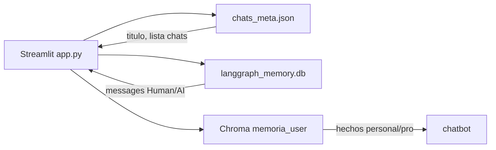
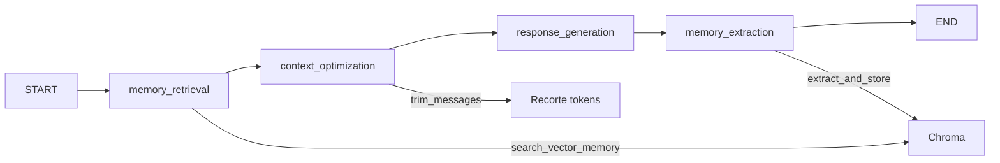

# Chat multi-usuario — notas de arquitectura

Proyecto: [`multiuser_chat_system/`](multiuser_chat_system/). App Streamlit con memoria híbrida por usuario.

---

## Estructura de archivos

| Archivo | Rol |
| --- | --- |
| [`app.py`](multiuser_chat_system/app.py) | UI Streamlit: usuarios, lista de chats, chat, panel de memorias |
| [`chatbot.py`](multiuser_chat_system/chatbot.py) | Grafo LangGraph (4 nodos) + `SqliteSaver` por usuario |
| [`memory_manager.py`](multiuser_chat_system/memory_manager.py) | Chroma por usuario, metadatos JSON, extracción de memorias |
| [`config.py`](multiuser_chat_system/config.py) | Rutas, modelo, constantes |
| [`utils.py`](multiuser_chat_system/utils.py) | Formato de fechas, validación de user id |

Datos en disco (por usuario):

```
users/
  {user_id}/
    chats_meta.json          # títulos, fechas, contadores (ligero)
    chromadb/                # memoria vectorial transversal
    langgraph_memory.db      # checkpoints de conversación
```

---

## Tres almacenes distintos



| Almacén | Qué guarda | Para qué |
| --- | --- | --- |
| `chats_meta.json` | Metadatos de chats (título, fechas) | Sidebar estilo ChatGPT |
| `langgraph_memory.db` | Checkpoints con `messages` | Historial de mensajes por chat |
| Chroma | Fragmentos extraídos del LLM | Recordar facts entre chats |

---

## `thread_id` compuesto

En [`chatbot.py`](multiuser_chat_system/chatbot.py):

```python
config = {"configurable": {"thread_id": f"user_{self.user_id}_chat_{chat_id}"}}
```

- Un **usuario** puede tener **varios chats** (UUID cada uno).
- Cada par usuario+chat = un hilo LangGraph independiente.
- Mismo patrón que Tema 4, pero el id incluye `user_id` y `chat_id`.

Doc: [Checkpointers — Threads](https://docs.langchain.com/oss/python/langgraph/checkpointers#threads)

---

## Grafo LangGraph (4 nodos)



| Nodo | Función |
| --- | --- |
| `memory_retrieval` | Busca memorias vectoriales relevantes al último mensaje |
| `context_optimization` | `trim_messages` (max ~4000 tokens) |
| `response_generation` | Prompt + LLM con contexto de memorias |
| `memory_extraction` | LLM extrae facts → guarda en Chroma (si importancia ≥ 2) |

State: `MemoryState` en [`memory_manager.py`](multiuser_chat_system/memory_manager.py):

- `messages` — `Annotated[..., add_messages]`
- `vector_memories` — strings recuperados en este turno
- `last_memory_extraction` — evita duplicar extracción del mismo mensaje

---

## Flujo en la UI

1. Usuario elige o crea `user_id` → `ChatbotManager.get_chatbot(user_id)`.
2. “Nuevo chat” → `create_new_chat()` → nuevo UUID en JSON.
3. Usuario escribe → `chatbot.chat(message, chat_id)` → `invoke` con `thread_id` compuesto.
4. Historial en pantalla → `get_conversation_history(chat_id)` lee `get_state(config)`.
5. “Ver memorias” → `get_all_vector_memories()` desde Chroma.

---

## Diferencia vs scripts simples de Tema 5

| | Scripts terminal | Multi-usuario |
| --- | --- | --- |
| Usuarios | Uno implícito | Varios carpetas `users/` |
| Chats | Un `thread_id` fijo | Un thread por chat UUID |
| Metadatos UI | Ninguno | `chats_meta.json` |
| Extracción memoria | Reglas fijas o LLM simple | `PydanticOutputParser` + categorías |

---

## Enlaces

- [LangGraph Persistence](https://docs.langchain.com/oss/python/langgraph/persistence)
- [RunnableWithMessageHistory vs LangGraph](https://docs.langchain.com/oss/python/langgraph/add-memory) (memoria en grafos)
- Ver también [`MEMORIA_NOTAS.md`](MEMORIA_NOTAS.md)
