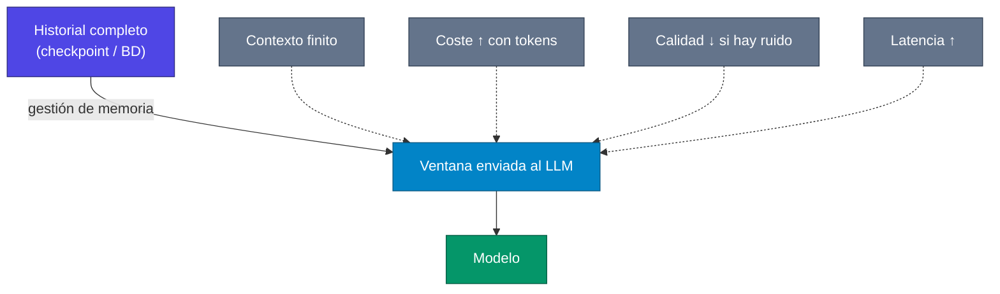
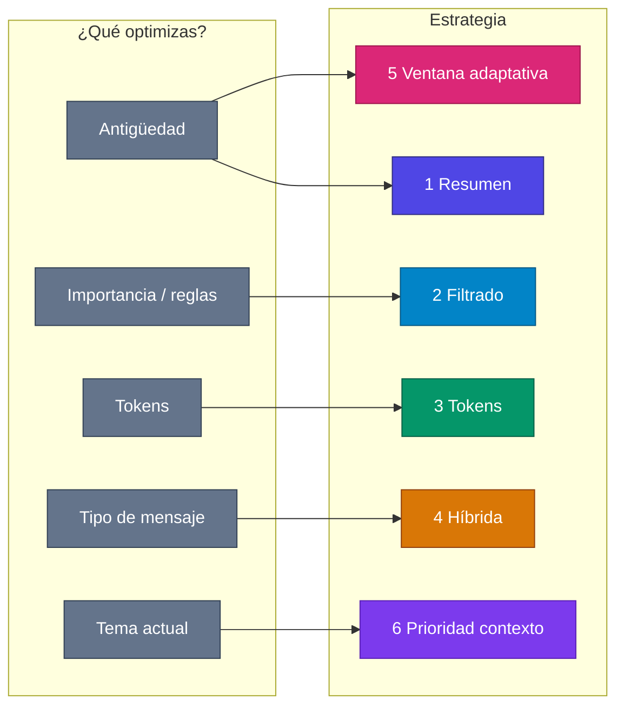
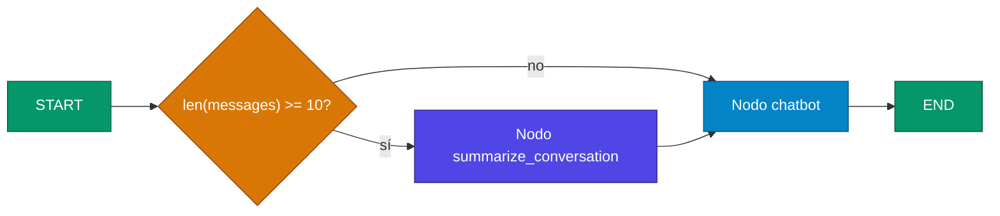
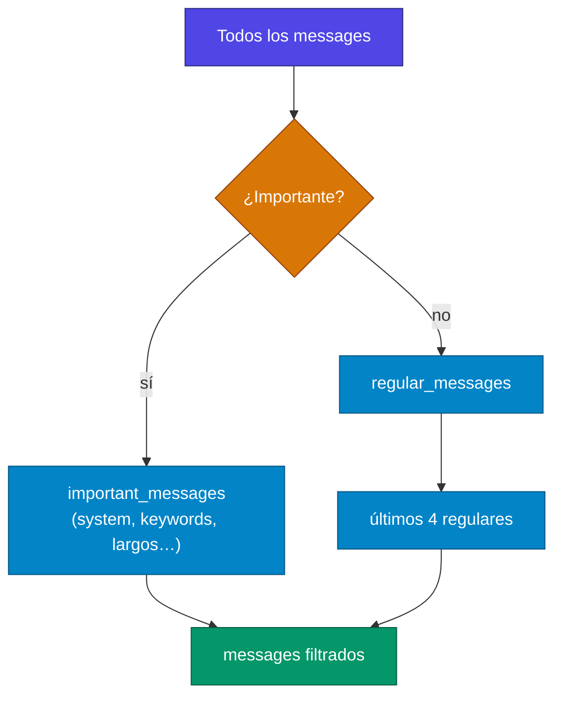
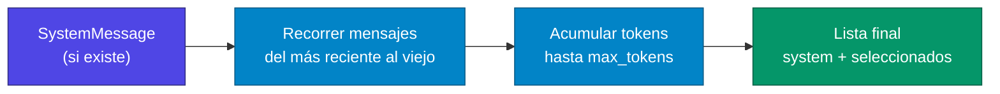
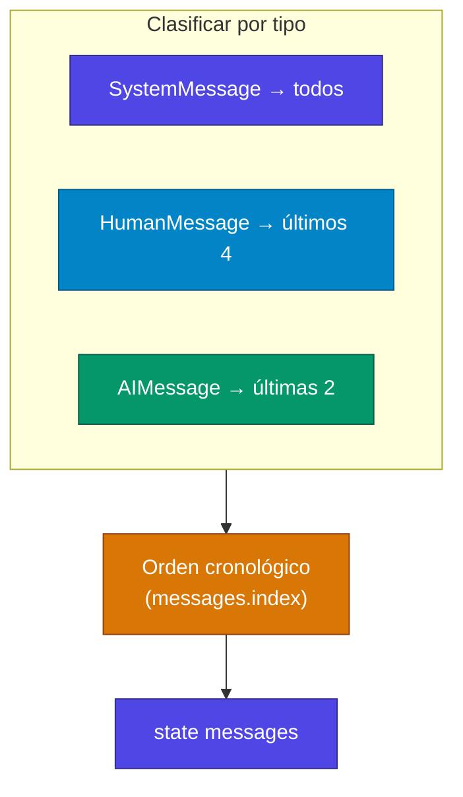
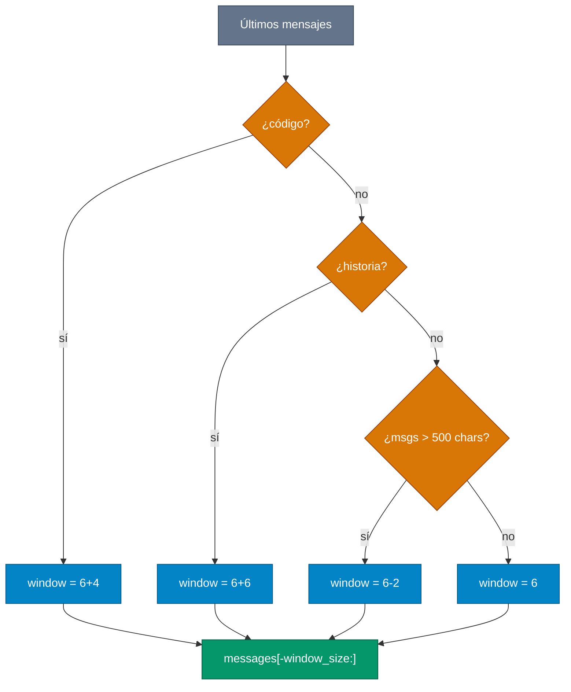
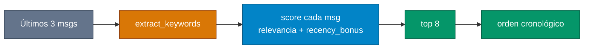

# Lectura: Tipos de memoria principales con LangGraph

La gestión inteligente de memoria es fundamental para crear agentes conversacionales efectivos. Mientras que la memoria básica y la ventana deslizante cubren casos fundamentales, existen estrategias más sofisticadas que pueden transformar significativamente la experiencia del usuario. En este artículo, exploraremos las técnicas de gestión de memoria más importantes que puedes implementar en LangGraph.

Mapa del tema y scripts del curso: `[MEMORIA_NOTAS.md](MEMORIA_NOTAS.md)`.

### Índice de estudio


| #   | Estrategia                                                          | Idea en una línea                        |
| --- | ------------------------------------------------------------------- | ---------------------------------------- |
| —   | [Problema](#el-problema-de-la-memoria-ilimitada)                    | Por qué no basta con guardar todo        |
| 1   | [Resumen](#1-memoria-de-resumen-summarization-memory)               | Comprimir lo viejo en un `SystemMessage` |
| 2   | [Filtrado](#2-memoria-de-filtrado-inteligente)                      | Conservar mensajes “importantes”         |
| 3   | [Tokens](#3-memoria-por-límite-de-tokens)                           | Recortar por presupuesto de tokens       |
| 4   | [Híbrida](#4-memoria-híbrida-por-tipo-de-mensaje)                   | Reglas distintas por Human / AI / System |
| 5   | [Ventana adaptativa](#5-memoria-con-ventana-deslizante-adaptativa)  | Últimos N mensajes, N dinámico           |
| 6   | [Prioridad de contexto](#6-memoria-con-prioridad-de-contexto)       | Top-K por relevancia al tema actual      |
| —   | [Mejores prácticas](#mejores-prácticas) · [Conclusión](#conclusión) | Cierre del artículo                      |


**Leyenda de colores** (igual que en Tema 3–4): índigo = estado / memoria persistida · azul = procesamiento · verde = salida / LLM · naranja = decisión / routing · gris = restricciones o entrada · rosa = vectorial / recuperación semántica.

---


## El Problema de la Memoria Ilimitada

Antes de explorar las soluciones, es crucial entender por qué necesitamos estrategias de gestión de memoria:

- **Limitaciones de contexto:** Los LLMs tienen ventanas de contexto finitas
- **Costos crecientes:** Más tokens significan mayor costo por llamada
- **Degradación de rendimiento:** Contextos muy largos pueden distraer al modelo
- **Latencia:** Procesar historiales extensos aumenta el tiempo de respuesta




> **Para aclarar:** en LangGraph el **checkpointer** puede guardar **todos** los mensajes del hilo (`thread_id`), pero el nodo del chatbot suele **recortar o transformar** la lista antes de `llm.invoke(...)`. La memoria “ilimitada” en disco no implica contexto ilimitado en el modelo. Ver ventana deslizante en `[memoria_ventana_deslizante.py](memoria_ventana_deslizante.py)` y `[MEMORIA_NOTAS.md](MEMORIA_NOTAS.md)`.

---


## Estrategias de Gestión de Memoria

Las seis técnicas siguientes son **patrones de nodo** (o pre-procesado en el nodo del LLM) más **aristas condicionales** que deciden cuándo aplicarlas. No son excluyentes: en producción a menudo combinas resumen + límite de tokens + reglas de system.




| Estrategia         | Dispara cuando…                      | ¿Llama al LLM extra?           | Riesgo principal                               |
| ------------------ | ------------------------------------ | ------------------------------ | ---------------------------------------------- |
| Resumen            | Muchos turnos (ej. ≥ 10 msgs)        | Sí (generar resumen)           | Perder matices no reflejados en el resumen     |
| Filtrado           | Historial largo + reglas/heurísticas | No (solo reglas)               | Falsos negativos (“importante” no detectado)   |
| Tokens             | Suma de tokens > umbral              | No                             | Estimación imprecisa si no usas tokenizer real |
| Híbrida            | Mezcla de tipos de mensaje           | No                             | Orden cronológico artificial sin timestamps    |
| Ventana adaptativa | `len(messages) > window_size`        | No (solo heurística de tamaño) | Ventana demasiado pequeña en código largo      |
| Prioridad contexto | Tema cambia pero hay mucho historial | Opcional (NLP/embeddings)      | Keywords demasiado simples vs. sinónimos       |


---


## 1. Memoria de Resumen (Summarization Memory)

Esta estrategia condensa automáticamente conversaciones largas en resúmenes concisos, preservando el contexto esencial mientras mantiene el historial manejable.

**Cuándo usar:** Conversaciones largas donde el contexto histórico es importante pero no necesitas cada detalle.




> **Nota de implementación:** el state incluye `conversation_summary` para **resumir de forma incremental** (nuevo lote + resumen anterior). Los mensajes recientes se mantienen literales; lo antiguo pasa a un único `SystemMessage` con el resumen. La función `should_summarize` encaja como **routing** (`"summarize"` vs `"continue"`) en LangGraph.

```python
from typing import TypedDict, List
from langchain_core.messages import BaseMessage, SystemMessage, HumanMessage, AIMessage


class ChatState(TypedDict):
    messages: List[BaseMessage]
    conversation_summary: str
    message_count: int


def summarize_conversation(state: ChatState) -> dict:
    """Condensa mensajes antiguos en un resumen cuando se alcanza el límite"""
    messages = state["messages"]
    current_summary = state.get("conversation_summary", "")

    # Si tenemos menos de 10 mensajes, no resumir aún
    if len(messages) < 10:
        return {"message_count": len(messages)}

    # Mantener los últimos 4 mensajes y resumir el resto
    recent_messages = messages[-4:]
    messages_to_summarize = messages[:-4]

    # Crear prompt para resumir
    summary_prompt = f"""
    Resumen anterior: {current_summary}

    Nuevos mensajes a resumir:
    {[f"{msg.type}: {msg.content}" for msg in messages_to_summarize]}

    Crea un resumen conciso que capture los puntos clave de la conversación.
    """

    # Aquí llamarías a tu LLM para generar el resumen
    new_summary = "Resumen actualizado de la conversación..."  # Placeholder

    # Crear mensaje de sistema con el resumen
    summary_message = SystemMessage(content=f"Resumen de conversación previa: {new_summary}")

    return {
        "messages": [summary_message] + recent_messages,
        "conversation_summary": new_summary,
        "message_count": len(recent_messages) + 1,
    }


def  (state: ChatState) -> str:
    """Decide si necesitamos resumir la conversación"""
    if len(state["messages"]) >= 10:
        return "summarize"
    return "continue"
```

---


## 2. Memoria de Filtrado Inteligente

En lugar de eliminar mensajes por antigüedad, esta estrategia mantiene los mensajes más relevantes o importantes según criterios específicos.

**Cuándo usar:** Cuando algunos mensajes son más valiosos que otros (decisiones importantes, preferencias del usuario, etc.).




> **Nota de implementación:** `analyze_message_importance` → arista a nodo `filter_important_messages` antes del LLM. Puedes sustituir keywords fijas por un **mini-clasificador** (LLM o reglas de negocio). En el proyecto multi-usuario, la extracción de “facts” a Chroma es otra capa; ver `[MULTIUSER_NOTAS.md](MULTIUSER_NOTAS.md)`.

```python
def filter_important_messages(state: ChatState) -> dict:
    """Mantiene mensajes importantes y elimina menos relevantes"""
    messages = state["messages"]

    if len(messages) <= 8:
        return {}  # No necesita filtrado aún

    important_messages = []
    regular_messages = []

    for msg in messages:
        # Criterios para mensajes importantes
        is_important = (
            isinstance(msg, SystemMessage)  # Siempre mantener system messages
            or "importante" in msg.content.lower()
            or "recuerda" in msg.content.lower()
            or "preferencia" in msg.content.lower()
            or len(msg.content) > 200  # Mensajes largos pueden ser importantes
        )

        if is_important:
            important_messages.append(msg)
        else:
            regular_messages.append(msg)

    # Mantener todos los importantes + los 4 regulares más recientes
    filtered_messages = important_messages + regular_messages[-4:]

    return {"messages": filtered_messages}


def analyze_message_importance(state: ChatState) -> str:
    """Decide si aplicar filtrado por importancia"""
    if len(state["messages"]) > 8:
        return "filter"
    return "continue"
```

---


## 3. Memoria por Límite de Tokens

Gestiona la memoria basándose en el conteo real de tokens, proporcionando control preciso sobre el uso del contexto.

**Cuándo usar:** Cuando necesitas optimización precisa de costos o trabajas cerca de límites de contexto específicos.




> **Para aclarar:** `estimate_tokens` (÷4 caracteres) sirve para **aprender el patrón**; en producción usa el contador del modelo (`tiktoken`, `trim_messages` con `token_counter=...`) como en `[memoria_ventana_deslizante.py](memoria_ventana_deslizante.py)`. `check_token_limit` puede ir **antes** del nodo LLM o fusionarse con `manage_memory_by_tokens` en un solo nodo `context_optimization` (nombre usado en el chat multi-usuario).

```python
def estimate_tokens(text: str) -> int:
    """Estimación simple de tokens (aproximadamente 4 caracteres por token)"""
    return len(text) // 4


def manage_memory_by_tokens(state: ChatState, max_tokens: int = 2000) -> dict:
    """Gestiona memoria basándose en límite de tokens"""
    messages = state["messages"]

    # Calcular tokens actuales
    total_tokens = sum(estimate_tokens(msg.content) for msg in messages)

    if total_tokens <= max_tokens:
        return {}  # No necesita gestión

    # Estrategia: mantener primer mensaje (system) + mensajes más recientes
    if messages and isinstance(messages[0], SystemMessage):
        system_msg = messages[0]
        other_messages = messages[1:]
        current_tokens = estimate_tokens(system_msg.content)
    else:
        system_msg = None
        other_messages = messages
        current_tokens = 0

    # Agregar mensajes desde el más reciente hasta alcanzar el límite
    selected_messages = []
    for msg in reversed(other_messages):
        msg_tokens = estimate_tokens(msg.content)
        if current_tokens + msg_tokens <= max_tokens:
            selected_messages.insert(0, msg)
            current_tokens += msg_tokens
        else:
            break

    # Reconstruir lista de mensajes
    final_messages = []
    if system_msg:
        final_messages.append(system_msg)
    final_messages.extend(selected_messages)

    return {"messages": final_messages}


def check_token_limit(state: ChatState) -> str:
    """Verifica si necesitamos gestión por tokens"""
    total_tokens = sum(estimate_tokens(msg.content) for msg in state["messages"])
    if total_tokens > 2000:
        return "manage_tokens"
    return "continue"
```

---


## 4. Memoria Híbrida por Tipo de Mensaje

Aplica diferentes estrategias de retención según el tipo de mensaje, optimizando para diferentes patrones de uso.

**Cuándo usar:** En agentes que manejan diferentes tipos de interacciones (comandos, chat casual, tareas específicas).




> **Nota de estudio:** las respuestas del asistente suelen ser más verbosas; por eso se guardan **menos** turnos AI que Human. Si usas **tool calling**, añade ramas para `ToolMessage` / `AIMessage` con `tool_calls` para no romper el hilo de una herramienta a medias.

```python
def hybrid_memory_management(state: ChatState) -> dict:
    """Aplica diferentes estrategias según el tipo de mensaje"""
    messages = state["messages"]

    if len(messages) <= 6:
        return {}

    system_messages = []
    human_messages = []
    ai_messages = []

    # Clasificar mensajes por tipo
    for msg in messages:
        if isinstance(msg, SystemMessage):
            system_messages.append(msg)
        elif isinstance(msg, HumanMessage):
            human_messages.append(msg)
        elif isinstance(msg, AIMessage):
            ai_messages.append(msg)

    # Estrategias diferenciadas:
    # - Mantener TODOS los system messages
    # - Mantener los últimos 4 human messages
    # - Mantener solo las últimas 2 AI responses

    filtered_messages = []
    filtered_messages.extend(system_messages)  # Todos los system
    filtered_messages.extend(human_messages[-4:])  # Últimos 4 human
    filtered_messages.extend(ai_messages[-2:])  # Últimas 2 AI

    # Reordenar cronológicamente
    # (En implementación real, mantendrías timestamps)
    filtered_messages.sort(key=lambda x: messages.index(x))

    return {"messages": filtered_messages}
```

---


## 5. Memoria con Ventana Deslizante Adaptativa

Extiende la ventana deslizante básica con lógica adaptativa que ajusta el tamaño de la ventana según el contexto.

**Cuándo usar:** Cuando la importancia del contexto varía según el tipo de conversación o tarea.

Implementación de referencia en el curso: `[memoria_ventana_deslizante.py](memoria_ventana_deslizante.py)`.




> **Comparar con el script del curso:** la ventana **fija** del ejemplo usa `trim_messages(strategy="last", max_tokens=...)`: recorta por **tokens**, no por número de mensajes. La ventana **adaptativa** del artículo cambia **cuántos mensajes** conservas según heurísticas de contenido. Puedes unir ambas: primero adaptar N, luego `trim_messages` sobre ese subconjunto.

```python
def adaptive_sliding_window(state: ChatState) -> dict:
    """Ventana deslizante que se adapta al contexto"""
    messages = state["messages"]

    # Determinar tamaño de ventana basado en el contexto
    window_size = calculate_adaptive_window_size(state)

    if len(messages) <= window_size:
        return {}

    # Mantener los mensajes más recientes
    recent_messages = messages[-window_size:]

    return {"messages": recent_messages}


def calculate_adaptive_window_size(state: ChatState) -> int:
    """Calcula tamaño de ventana dinámicamente"""
    messages = state["messages"]

    # Ventana base
    base_size = 6

    # Ajustes según patrones detectados
    if any("código" in msg.content.lower() for msg in messages[-3:]):
        return base_size + 4  # Más contexto para programación

    if any("historia" in msg.content.lower() for msg in messages[-2:]):
        return base_size + 6  # Más contexto para narrativas

    if any(len(msg.content) > 500 for msg in messages[-2:]):
        return base_size - 2  # Menos mensajes si son muy largos

    return base_size


def determine_window_strategy(state: ChatState) -> str:
    """Decide qué estrategia de ventana usar"""
    if len(state["messages"]) > calculate_adaptive_window_size(state):
        return "adaptive_window"
    return "continue"
```

---


## 6. Memoria con Prioridad de Contexto

Mantiene mensajes basándose en su relevancia para la conversación actual, usando análisis semántico simple.

**Cuándo usar:** Conversaciones que saltan entre temas pero donde el contexto temático es crucial.




> **Para aclarar:** `recency_bonus` evita que un mensaje viejo pero muy keyword-rich desplace el turno inmediato anterior. Evolución natural: embeddings + similitud coseno (como Chroma en `[memoria_vectorial_langgraph.py](memoria_vectorial_langgraph.py)`), no solo contar palabras en común.

```python
def priority_context_memory(state: ChatState) -> dict:
    """Mantiene mensajes relevantes al contexto actual"""
    messages = state["messages"]

    if len(messages) <= 8:
        return {}

    # Obtener temas de los últimos mensajes
    recent_content = " ".join([msg.content for msg in messages[-3:]])
    current_keywords = extract_keywords(recent_content)

    # Puntuar mensajes por relevancia
    scored_messages = []
    for i, msg in enumerate(messages):
        relevance_score = calculate_relevance(msg.content, current_keywords)
        # Los mensajes más recientes tienen bonus
        recency_bonus = max(0, len(messages) - i) * 0.1
        total_score = relevance_score + recency_bonus
        scored_messages.append((total_score, msg))

    # Mantener top 8 mensajes más relevantes
    scored_messages.sort(reverse=True)
    selected_messages = [msg for _, msg in scored_messages[:8]]

    # Reordenar cronológicamente
    selected_messages.sort(key=lambda x: messages.index(x))

    return {"messages": selected_messages}


def extract_keywords(text: str) -> List[str]:
    """Extrae palabras clave simples del texto"""
    # Implementación simple - en producción usarías NLP más sofisticado
    words = text.lower().split()
    # Filtrar palabras comunes y mantener palabras significativas
    stop_words = {"el", "la", "de", "que", "y", "en", "un", "es", "se", "no", "te", "lo"}
    keywords = [word for word in words if len(word) > 3 and word not in stop_words]
    return list(set(keywords))[:10]  # Top 10 keywords únicos


def calculate_relevance(text: str, keywords: List[str]) -> float:
    """Calcula relevancia simple basada en keywords"""
    text_lower = text.lower()
    matches = sum(1 for keyword in keywords if keyword in text_lower)
    return matches / max(len(keywords), 1)
```

---


## Pipeline de ejemplo (combinar estrategias)

Patrón típico en un grafo de chat avanzado (similar espíritu al multi-usuario: recuperar → optimizar contexto → responder):

```mermaid
flowchart LR
    START --> RET["Recuperar memoria<br/>vectorial (opcional)"]
    RET --> SUM{"¿Resumir?"}
    SUM -->|sí| N1["summarize_conversation"]
    SUM -->|no| FIL{"¿Filtrar?"}
    N1 --> FIL
    FIL -->|sí| N2["filter_important_messages"]
    FIL -->|no| TOK{"¿Tokens?"}
    N2 --> TOK
    TOK -->|sí| N3["manage_memory_by_tokens"]
    TOK -->|no| LLM["response_generation"]
    N3 --> LLM
    LLM --> END

    classDef io fill:#059669,stroke:#065F46,color:#fff
    classDef vec fill:#DB2777,stroke:#9D174D,color:#fff
    classDef dec fill:#D97706,stroke:#92400E,color:#fff
    classDef n1 fill:#4F46E5,stroke:#312E81,color:#fff
    classDef n2 fill:#0284C7,stroke:#075985,color:#fff
    classDef n3 fill:#7C3AED,stroke:#5B21B6,color:#fff
    classDef chat fill:#0284C7,stroke:#075985,color:#fff

    class START,END io
    class RET vec
    class SUM,FIL,TOK dec
    class N1 n1
    class N2,LLM chat
    class N3 n3
```




> **Nota:** no hace falta encadenar **las seis** siempre; elige según métricas (coste, quejas de “no recuerdas”, latencia). Empieza por tokens o ventana, luego añade resumen si pierdes hilo en conversaciones largas.

---


## Mejores Prácticas

- **Empieza Simple:** Comienza con ventana deslizante y evoluciona según necesidades
- **Mide el Impacto:** Monitorea tokens usados, costos y calidad de respuestas
- **Ajusta Dinámicamente:** Permite configuración de parámetros basada en feedback
- **Mantén Transparencia:** Informa al usuario cuando se pierde contexto
- **Testa Exhaustivamente:** Diferentes estrategias funcionan mejor para diferentes casos

**Checklist rápido para practicar**

1. ¿El checkpoint guarda más de lo que el LLM ve? (debería ser sí en ventana/resumen/tokens)
2. ¿El `SystemMessage` de resumen **reemplaza** bloques viejos sin borrar el checkpoint completo?
3. ¿Probaste el mismo `thread_id` con 15+ turnos y comparaste respuestas con/sin gestión?
4. ¿Los umbrales (10 msgs, 2000 tokens, 8 msgs filtrados) están en **config**, no hardcodeados?

---


## Conclusión

La gestión efectiva de memoria en LangGraph va mucho más allá de simplemente mantener los últimos N mensajes. Las estrategias avanzadas como memoria de resumen, filtrado inteligente y ventanas adaptativas pueden transformar dramáticamente la experiencia del usuario, permitiendo conversaciones más largas, contextualizadas y costo-eficientes.

La clave está en entender tu caso de uso específico y elegir la combinación correcta de estrategias. Experimenta con diferentes enfoques, mide su impacto en la calidad de las respuestas y optimiza según los patrones de uso reales de tus usuarios.

En los próximos videos del curso, veremos cómo implementar algunas de estas estrategias paso a paso, incluyendo la integración con LLMs para operaciones como resumir y analizar relevancia de contexto.

---


## Enlaces del repositorio (Tema 5)


| Recurso                                                            | Uso                                                   |
| ------------------------------------------------------------------ | ----------------------------------------------------- |
| `[MEMORIA_NOTAS.md](MEMORIA_NOTAS.md)`                             | Mapa de scripts y capas de memoria                    |
| `[memoria_ventana_deslizante.py](memoria_ventana_deslizante.py)`   | `trim_messages` + checkpoint                          |
| `[memoria_vectorial_langgraph.py](memoria_vectorial_langgraph.py)` | Chroma + sesión (complemento a prioridad de contexto) |
| `[MULTIUSER_NOTAS.md](MULTIUSER_NOTAS.md)`                         | Pipeline retrieval → trim → LLM → extracción          |


Doc oficial útil: [trim_messages](https://python.langchain.com/api_reference/core/messages/langchain_core.messages.utils.trim_messages.html) · [LangGraph Persistence](https://docs.langchain.com/oss/python/langgraph/persistence)